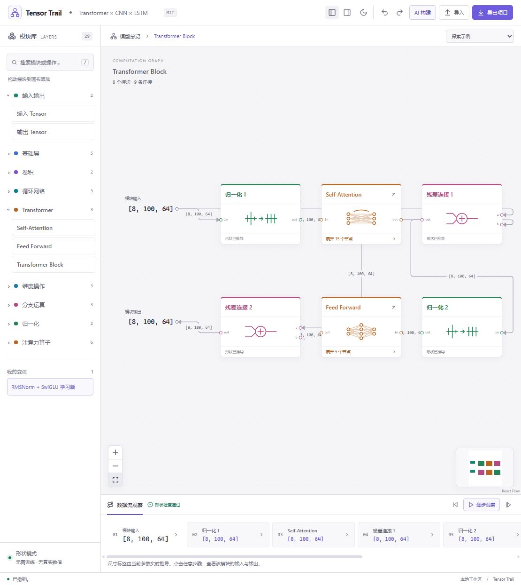

# Tensor Trail

**搭建神经网络，沿着数据流理解每一步 Tensor 形状的变化。**

Tensor Trail 是本地运行的神经网络学习工作台。定义输入 Tensor，手动连接 Transformer、CNN、RNN 和维度操作；修改参数后，即时查看每个节点及连线的形状，定位不兼容的维度。

Windows / Ubuntu 桌面开发版共用同一套编辑器：Windows 双击 [start-desktop.cmd](start-desktop.cmd)，Ubuntu 在图形桌面终端运行 [./start-desktop.sh](start-desktop.sh)，构建后打开独立窗口，使用原生项目打开与保存。Ubuntu 可用 `./start-desktop.sh --install-launcher` 添加应用菜单入口。网页版继续保留；安装包尚未交付，详见[桌面运行说明](apps/desktop/README.md)。



## v0.1 功能

- 算子覆盖线性层、卷积、RNN/GRU/LSTM、维度操作与分支合并。画布按当前层级显示可添加项，完整目录可通过下文的 CLI `describe` 查询，`describe --internal` 包含内部项。
- 用 `For`、`ForEach`、`While` 循环子图表达控制流并分析形状。用 `if` 条件范围框标记代码范围，用布局分区组织同层节点。见[模型绘图规范与验收清单](docs/模型绘图规范与验收清单.md)。
- 计算库的“读取维度 Size”可查询多个轴并分别输出整数尺寸，支持变量名称、负轴和符号尺寸；见[读取维度](docs/读取维度.md)。
- 计算库的“函数”以数学公式封装单输入、单输出的浮点逐元素运算，画布只显示名称，公式在右侧编辑；支持 PLUTO 的角度归一化以及 Python/PyTorch 语义的取模。见[函数模块](docs/函数模块.md)。
- 计算库提供紧凑的 `Cos`、`Sin`、整数乘法与动态 `View`；`Cat` / `Stack` 可选择 1–16 路输入，保留输入顺序。`View` 可接局部整数作为目标维度，`Flatten` 可从轴 0 展开。见[特征拼接与动态形状](docs/特征拼接与动态形状.md)。
- 支持 PLUTO 的 `NATSequenceEncoder` 分层画布：布尔车辆筛选、Permute、Contiguous、三级 NAT 与多尺度融合；复杂算子使用可查看代码的函数模板。参见[NAT 历史编码](docs/NAT历史编码.md)。
- 计算库提供可双击展开的 `to_vector` 双输入辅助函数，内部保留相邻帧掩码、差分、补维与无效置零；配套提供 `&`、减法、`Where`、`ZerosLike` 和补齐末尾维度的紧凑节点。
- 模块库提供“局部参数”：将计算得到的整数尺寸命名为 `bs`、`A` 等，画布仅显示小型名称节点，数值与类型在属性中查看，并有输入、输出端口。同一画布内的同名独立定义自动用不同颜色区分，关联副本跟随各自来源的颜色。
- 模块库的“张量变量”（`TensorVariable`）为 `agent_pos` 等中间 Tensor 命名，使用青色边框，显示名称和形状，保留 Tensor 的尺寸、轴含义与 dtype，左右接口可继续连接下游计算；双击名称可改名。它没有可训练参数，整数尺寸使用“局部参数”，网络最终返回值使用只有输入接口的“输出 Tensor”。
- 新建空白项目、模块组复制粘贴、逐轴注释，以及支持切片、取反和 any() 的计算模块。Tensor 背景按 `requires_grad` 的 on/off/未知状态在“张量配色”页签统一管理；逐节点可自定义边框色，旧背景色自动迁移为边框色。
- 同一画布内仅“局部参数”默认复制为关联副本；张量变量、网络输入等其他节点默认独立复制，多处使用同一数据时优先从原节点分支连线。需要共享值时，可在右侧明确点击“创建关联副本”；已有值关联仍支持整组高亮、参数同步和解除链接。跨画布或跨项目粘贴不关联原节点。
- 网络输入（`ForwardInput`）采用与 Tensor 输入一致的紧凑圆角样式，画布只显示名称；属性中可保存嵌套字典类型、各 Tensor 的尺寸、dtype 和自动求导元数据，也可暂不指定结构。支持自定义边框色、名称修改和布局保存，兼容旧字典与列表输入。
- 字典数据统一由“网络输入”表示，可编辑 Tensor 形状、类型并传递整份字典；模块库不再单列“字典输入”。“探索示例”提供 PLUTO 的 `data` 输入接口示例。见[字典输入说明](docs/字典输入.md)。
- 右侧“模型超参数”管理项目级配置；计算库提供字典字段读取和统一的“索引与切片”模块，可切换单元素索引与范围切片，引用 `history_steps - 1` 等超参数表达式，并实时推导形状。旧 Slice 与整数索引节点打开后自动兼容。见[超参数与索引](docs/超参数与索引.md)。
- Q/K/V 三输入多头注意力，支持交叉注意力、不同序列长度和 K/V 特征宽度，可展开观察投影、拆头和分数矩阵。
- Transformer → Self-Attention / FFN → Q/K/V、拆头、矩阵乘法等多层子图展开。
- 默认以主模型的 `forward()` 为根画布；直接计算留在当前层，子模块保持封装，双击进入内部 `forward()`，通过面包屑返回。画布顶部“分层规则”可查看约定；详见[宏观目标与演进方向](宏观目标与演进方向.md)。此约定已用于现有图的浏览，PyTorch 自动导入和代码生成仍待实现。
- Pre-Norm / Post-Norm、LayerNorm / RMSNorm、Standard FFN / SwiGLU；可编辑内部算子并保存为独立变体。
- Tensor 轴含义、命名输入输出端口、实时约束检查与逐步高亮。
- 左侧提供同级、可独立折叠的“模块库”和“计算库”，共用搜索；计算库收纳现有计算模块、切片、维度操作、分支运算和注意力算子。两库均可拖入画布，保存的自定义变体位于模块库中。
- 同一输出的自动分支共同规划干线，目标位置不同也能合并；拖动模块靠近端口或已有线路时会吸附对齐并显示辅助线，按住 Alt 可自由移动。节点与路线一起保存和撤销，见[连线与模块吸附](docs/连线与模块吸附.md)。
- 输入与输出端口可独立设置在上、下、左、右；同一输出端口的连线在共享路径分岔处显示实心连接点，单纯交叉不表示连接。连线统一使用直角折线。选中后拖动水平段或竖直段即可平移该段；同一条折线的相邻平行段在 12 屏幕像素内会对齐拉直，清除中间折角，保留端口位置；同一输出端口的平行线段在拖动时接近 12 屏幕像素且有重叠部分，会吸附合并共用干线，分岔实心点随之移动，模块位置保持不变（按住 Alt 可跳过拉直和合并）；支持 Escape 取消、撤销重做、保存和恢复自动布线，也保留双击加控制点的操作。
- 同一输出出发的公共线段只绘制一次，共享位置的相同文字也去重。分岔点将公共段分为可拖动的小段，拖动某一公共段会同步预览并一次提交所有经过它的分支，模块和端口位置保持不变。按住 Alt 开始拖动可单独调整当前分支；Escape 取消全部预览，一次撤销可恢复整组。不同来源或分岔后单纯交叉的线不会误合并；已有 JSON 自动适用，无需迁移数据连接。
- 连线高亮以分岔点为界：点击中间分支，高亮该分支及后续全部分岔；点击输出端的起始段，高亮同一数据来源的所有连线（包括明确关联的值副本）。上游和之前分出的兄弟分支保持原色，线段上的文字、箭头与分岔实心点同步高亮。同名或同尺寸的独立值不会联动，也不会跨越计算节点传播。点击画布空白处取消选择；高亮不改变连线、模块、保存内容或撤销历史。
- 连线文字显示在线条侧边，随选中的连线一起高亮；可直接拖动文字沿折线滑动，双击文字恢复默认位置。文字位置按连线长度比例保存，支持 Escape 取消、一次撤销、复制和保存重开；拖动文字不会改变线路或模块位置。
- 图编辑、撤销重做、JSON 打开与保存，以及宽屏和窄屏布局。
- 静态图与运行输入快照分离；“运行数据”切换实际输入形状/梯度状态，支持导出携带当前快照的单文件副本。字典 schema 使用 JSON 对象，兼容旧字符串格式。见[静态图与运行快照](docs/使用与扩展.md#静态图与运行快照)。
- 参考 TensorBloom 的深色工作台、可记忆的明暗主题、侧栏折叠、分类节点色标与当前层级概览；按 `/` 快速搜索模块。
- AI 构建：简化 JSON 配方、模块目录和 JSON Schema、构建/校验/批量修改 API、CLI，以及带版本冲突检查的画布应用入口。

内置混合网络展示：

```text
Input            [8, 100, 64]
  ↓ Transformer  [8, 100, 64]
  ↓ Permute      [8, 64, 100]
  ↓ Conv1d       [8, 128, 100]
  ↓ Permute      [8, 100, 128]
  ↓ LSTM         [8, 100, 32]
Output           [8, 100, 32]
```

## 运行

仓库登记的开发工具链为 Node.js 24.22.2 LTS 与 npm 11.19.1，见 `.node-version` 和 `toolchain.json`。项目要求 Node.js 22.12.0 或更高版本。请在项目根目录安装和运行，依赖统一由根 `package-lock.json` 管理。

```sh
git clone https://github.com/Edward-0333/tensor-trail.git
cd tensor-trail
npm ci
npm run dev:web -- --port 5178
```

访问终端显示的本地地址，通常为 `http://127.0.0.1:5178/`。Windows 双击根目录 `start.cmd`；原 `app/start.cmd` 和 `apps/web/start.cmd` 均转到这个入口，首次运行会安装根工作区依赖。

`.tools/` 是可选的本地工具链。配置后可用 `node scripts/npm.cjs` 代替 `npm`，也可直接使用系统中满足版本要求的 Node.js 和 npm。

网页开发服务默认只监听本机。启动或刷新后，在顶部点“打开”，或在空白页点“打开项目”，选择 JSON 项目文件。关闭或刷新前请先保存编辑。

- 桌面端打开项目后，Ctrl+S 保存回已关联文件，Ctrl+Shift+S 打开“另存为”。
- 网页端通过浏览器原生文件选择器打开项目时会关联源文件，授权写入后可用 Ctrl+S 写回。需要写回源文件时，建议使用支持该选择器的桌面版 Chrome 或 Edge。
- 网页端通过普通文件输入打开时只读取 JSON。可用“另存为”（Ctrl+Shift+S）选择保存目标，浏览器缺少原生保存选择器时会下载副本。
- 桌面端可自动读取项目当前引用的旁置快照，网页端需在“运行数据”中手动选择快照文件。引用外部快照的项目会阻止普通“另存为”。要分享本次运行，可用“运行数据”中的“导出当前运行单文件”。要保留外部快照，请整体复制项目 JSON 和对应的快照目录。

桌面命令也在根目录执行：`npm run desktop` 构建并打开本地窗口，`npm run dev:desktop` 启动支持界面热更新的开发窗口，`npm run test:desktop` 执行真实 Electron 窗口文件流程检查，`npm run test:desktop:experience` 检查 DPI、画布交互和本地项目副本的大图表现。桌面普通运行使用本地界面资源，无需启动网页版服务。体验测试默认读取 `data/pluto.tensor-trail.json`，缺少该文件时，请用 `npm run test:desktop:experience -- --project <路径>` 指定本地项目。

## 开发与验证

在项目根目录执行：

```sh
npm test
npm run test:cli
npm run build
npm run preview -- --port 5178
```

自动测试覆盖形状推导、输入结构、超参数索引与编辑事务；另有 CLI 端到端检查、TypeScript 检查及生产构建，浏览器交互验证见[第一版验收](docs/第一版验收.md)。

```text
packages/model-core/src/core/      图协议、TensorSpec、递归形状推导、序列化
packages/model-core/src/modules/   算子注册、形状规则、Transformer 组合子图
packages/model-core/src/agent/     Recipe/Patch、模块目录、Schema、构建与校验 API
packages/cli/scripts/       AI 命令行及端到端检查
examples/      AI 可读取的架构配方与修改示例
packages/editor-ui/src/editor/    编辑会话、画布、参数面板、历史与保存
packages/editor-ui/src/views/     节点与 Tensor 视图、模块专属可视化
packages/*/tests/         形状契约与编辑事务测试
docs/             设计、使用指南和验证记录
```

核心引擎使用纯 TypeScript，与 React 画布分离。新增算子时注册模块定义与形状规则；新增 Transformer 结构时组合已有算子；新增视觉效果时注册详情视图。

- [详细架构方案](docs/架构方案.md)
- [使用与扩展指南](docs/使用与扩展.md)
- [应用运行说明](apps/web/README.md)
- [AI 操作指南](docs/AI操作指南.md)
- [Windows 桌面版实施台账](docs/Windows桌面版实施台账.md)：已完成 M1 与 M2（D0～D5）；下一阶段 D6 制作 Windows 安装包。
- [Windows 桌面体验验收](docs/Windows桌面体验验收.md)：三种进程 DPI、54 项体验观察、大图测量与验证边界。
- [Ubuntu 桌面验证](docs/Ubuntu桌面验证.md)记录了在 Ubuntu 20.04.6 LTS x86_64 / X11 上的实测范围。

## 加载真实训练输入

可选的 Python 适配器可在 PyTorch 模型的 `forward(data)` 入口采集输入元数据，包括字典字段、shape、dtype 和 `requires_grad`。采集结果写入独立快照，主图登记运行引用并保留原有静态输入契约。网页可独立于 PyTorch 使用。采集流程及外部 PLUTO 项目的历史集成示例见[训练输入采集](docs/训练输入采集.md)。

## 让 AI 搭建模型

复用绘图流程请先阅读 [模型绘图规范与验收清单](docs/模型绘图规范与验收清单.md)：包含任务契约、调用与循环语义、分区和关联引用规则、验收清单及自动绘图提示词模板。仓库的 [AGENTS.md](AGENTS.md) 为后续绘图任务提供统一入口。

AI 生成 Recipe JSON 后，可在页面顶部“AI 构建”中粘贴，检查形状并应用到画布；也可在项目根目录运行：

```sh
npm run build:agent
node packages/cli/scripts/agent.mjs describe
node packages/cli/scripts/agent.mjs describe --internal
node packages/cli/scripts/agent.mjs schema recipe
node packages/cli/scripts/agent.mjs build examples/cnn-transformer.recipe.json --out model.json
node packages/cli/scripts/agent.mjs validate model.json
node packages/cli/scripts/agent.mjs patch model.json examples/swiglu.patch.json --out next.json
```

生成的项目可在网页顶部点击“打开”，或在空白页点击“打开项目”。页面 API 为 `window.tensorTrail`，提供读取、构建、校验、批量修改及携带 revision 的应用操作。CLI 只生成文件，不自动修改打开的网页。当前未接入内置大模型、MCP 或 HTTP REST 服务，接入步骤及可交给 AI 的工作指令见 [AI 操作指南](docs/AI操作指南.md)。

`--out` 默认拒绝覆盖已有文件，显式传入 `--force` 才允许覆盖。CLI 不会自动读取旁置快照。网页打开项目和 CLI 读取 JSON 时，每个输入均限 3,000,000 字节。节点数、边数、嵌套深度和 Patch 操作数的上限见 [CLI 约定与限制](docs/AI操作指南.md#cli-约定与限制)。

增量绘图支持 `--draft` / `{mode: 'draft'}`：允许暂缺最终输出和未连完的节点，结构错误及已知尺寸错误仍会阻止应用。Patch 默认保留已有节点坐标、连线拐点及标签位置；新节点可指定 `position`，已有节点可用 `set_position` 移动。只有显式 `layout` 操作或 `--layout auto` 才重排。

例如对逐步绘制中的 SparseWorld 图生成一个预览副本，不改原图：

```sh
node packages/cli/scripts/agent.mjs patch ../SparseWorld.tensor-trail.json examples/sparseworld-incremental.patch.json --draft --out ../SparseWorld.preview.tensor-trail.json
```

该示例只添加一个已有张量的展示节点，不新增模型运算。后续绘图优先使用 API/CLI 添加节点、连线、修改参数；仅当算子库缺少所需能力时才扩展源码。详细策略和画布调用示例见 [草稿与保留布局](docs/AI操作指南.md#草稿与保留布局)。

## 当前范围与后续方向

当前为**形状模式**，提供形状推导与约束检查。真实张量数值计算、模型训练、梯度和注意力权重计算均超出当前范围。符号维度仅做有限传播；自定义变体保存具体子图快照，暂不提供内部参数提升或任意节点封装界面。

后续计划包括 RoPE / GQA 等算子、更多 Transformer 变体、教学动画，以及用于数值前向和形状对照的 PyTorch 后端。具体支持范围见使用指南。

## 开源协议

Tensor Trail 的自有代码与文档采用 [MIT License](LICENSE)，版权署名为 `Copyright (c) 2026 Edward-0333`。允许使用、修改、分发和商业使用，包括闭源集成；复制或分发本软件的全部或重要部分时须保留版权与许可声明。软件按现状提供，不附带担保。

第三方依赖和参考项目遵循各自的许可证。

## 参考与贡献说明

交互与架构设计参考了 [TensorBloom](https://github.com/mdsunbeam/tensorbloom) 和 [NodeTorch](https://github.com/WilsonZheng0327/nodetorch)。本仓库包含独立实现的 Tensor Trail 代码，参考项目源码请到各自仓库获取。

项目需求与扩展方向由维护者提出，v0.1 的实现、文档与验证由 Codex（GPT-6）协助完成。算子契约与设计来源列于架构方案。
