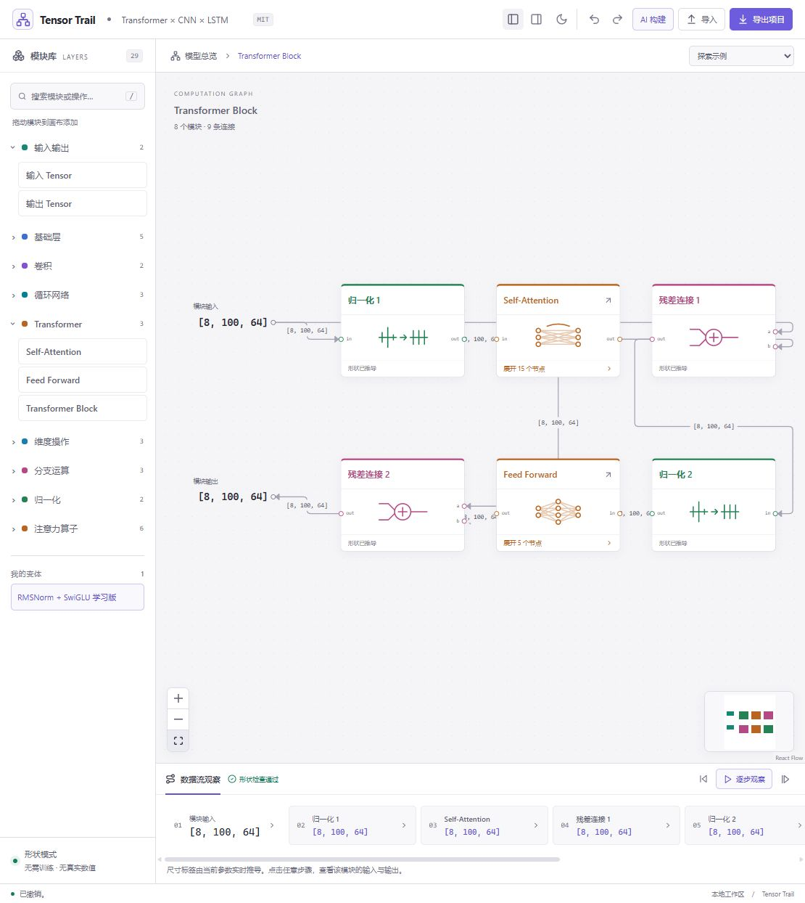

# Tensor Trail

**搭建神经网络，沿着数据流理解每一步 Tensor 形状的变化。**

Tensor Trail 是本地运行的神经网络学习工作台。定义输入 Tensor，手动连接 Transformer、CNN、RNN 和维度操作；修改参数后，即时查看每个节点及连线的形状，定位不兼容的维度。



## v0.1 功能

- 38 个可添加模块，覆盖线性层、卷积、RNN/GRU/LSTM、维度操作与分支合并。
- 计算库的“读取维度 Size”可查询多个轴并分别输出整数尺寸，支持变量名称、负轴和符号尺寸；见[读取维度](docs/读取维度.md)。
- 模块库提供“局部参数”：将计算得到的整数尺寸命名为 `bs`、`A` 等，画布仅显示小型名称节点，数值与类型在属性中查看，并有输入、输出端口。
- 模块库的“张量变量”（`TensorVariable`）为 `agent_pos` 等中间 Tensor 命名，使用青色边框，显示名称和形状，保留 Tensor 的尺寸、轴含义与 dtype，左右接口可继续连接下游计算；双击名称可改名。它没有可训练参数，整数尺寸使用“局部参数”，网络最终返回值使用只有输入接口的“输出 Tensor”。
- 新建空白项目、模块组复制粘贴、逐轴注释、Tensor 背景色，以及支持切片、取反和 any() 的计算模块。
- 网络输入（`ForwardInput`）采用与 Tensor 输入一致的紧凑圆角样式，画布只显示名称；属性中可保存嵌套字典类型、各 Tensor 的尺寸和 dtype，也可暂不指定结构。支持背景填充、名称修改和布局保存，兼容旧字典与列表输入。
- 字典数据统一由“网络输入”表示，可编辑 Tensor 形状、类型并传递整份字典；模块库不再单列“字典输入”。“探索示例”提供 PLUTO 的 `data` 输入接口示例。见[字典输入说明](docs/字典输入.md)。
- 右侧“模型超参数”管理项目级配置；计算库提供字典字段读取与张量整数索引，可用 `history_steps - 1` 或 `self.history_steps - 1` 引用参数，实时推导并检查边界。见[超参数与索引](docs/超参数与索引.md)。
- Q/K/V 三输入多头注意力，支持交叉注意力、不同序列长度和 K/V 特征宽度，可展开观察投影、拆头和分数矩阵。
- Transformer → Self-Attention / FFN → Q/K/V、拆头、矩阵乘法等多层子图展开。
- 默认以主模型的 `forward()` 为根画布；直接计算留在当前层，子模块保持封装，双击进入内部 `forward()`，通过面包屑返回。画布顶部“分层规则”可查看约定；详见[宏观目标与演进方向](宏观目标与演进方向.md)。此约定已用于现有图的浏览，PyTorch 自动导入和代码生成仍待实现。
- Pre-Norm / Post-Norm、LayerNorm / RMSNorm、Standard FFN / SwiGLU；可编辑内部算子并保存为独立变体。
- Tensor 轴含义、命名输入输出端口、实时约束检查与逐步高亮。
- 左侧提供同级、可独立折叠的“模块库”和“计算库”，共用搜索；计算库收纳现有计算模块、切片、维度操作、分支运算和注意力算子。两库均可拖入画布，保存的自定义变体位于模块库中。
- 输入与输出端口可独立设置在上、下、左、右；双击连线添加控制点并拖动调整路径，支持恢复自动布线。
- 图编辑、撤销重做、JSON 打开与保存，以及宽屏和窄屏布局。
- 每次启动为空白工作区，选择 JSON 后关联文件；Ctrl+S 写回原文件，Ctrl+Shift+S 另存为。
- 参考 TensorBloom 的深色工作台、可记忆的明暗主题、侧栏折叠、分类节点色标与当前层级概览；按 `/` 快速搜索模块。
- AI 构建：简化 JSON 配方、模块目录和 JSON Schema、构建/校验/批量修改 API、CLI，以及带版本冲突检查的画布应用入口。

内置混合网络展示：

```text
Input            [8, 100, 64]
  ↓ Transformer  [8, 100, 64]
  ↓ Permute      [8, 64, 100]
  ↓ Conv1d       [8, 128, 100]
  ↓ Permute      [8, 100, 128]
  ↓ LSTM         [8, 100, 32]
Output           [8, 100, 32]
```

## 运行

需要 Node.js 20 或更新版本与 npm。

```sh
git clone https://github.com/Edward-0333/tensor-trail.git
cd tensor-trail/app
npm ci
npm run dev -- --port 5178
```

访问终端显示的本地地址，通常为 `http://127.0.0.1:5178/`。Windows 也可以双击 `app/start.cmd`，首次运行会安装依赖并打开浏览器。

默认只监听本机。每次启动或刷新后需要手动选择 JSON 项目文件，关闭或刷新前请用 Ctrl+S 保存编辑。

## 开发与验证

在 `app/` 中执行：

```sh
npm test
npm run test:cli
npm run build
npm run preview -- --port 5178
```

自动测试覆盖形状推导、输入结构、超参数索引与编辑事务；另有 CLI 端到端检查、TypeScript 检查及生产构建，浏览器交互验证见[第一版验收](docs/第一版验收.md)。

```text
app/src/core/      图协议、TensorSpec、递归形状推导、序列化
app/src/modules/   算子注册、形状规则、Transformer 组合子图
app/src/agent/     Recipe/Patch、模块目录、Schema、构建与校验 API
app/scripts/       AI 命令行及端到端检查
app/examples/      AI 可读取的架构配方与修改示例
app/src/editor/    编辑会话、画布、参数面板、历史与保存
app/src/views/     节点与 Tensor 视图、模块专属可视化
app/tests/         形状契约与编辑事务测试
docs/             设计、使用指南和验证记录
```

核心引擎使用纯 TypeScript，与 React 画布分离。新增算子时注册模块定义与形状规则；新增 Transformer 结构时组合已有算子；新增视觉效果时注册详情视图。

- [详细架构方案](docs/架构方案.md)
- [使用与扩展指南](docs/使用与扩展.md)
- [应用运行说明](app/README.md)
- [AI 操作指南](docs/AI操作指南.md)

## 加载真实训练输入

可选的 Python 适配器可以在 PyTorch 模型的 `forward(data)` 入口采集字典字段、shape 和 dtype，再更新保存的 Tensor Trail 项目。PLUTO 已提供复用当前训练配置的采集脚本；网页仍不依赖 PyTorch。操作和实际采集结果见[训练输入采集](docs/训练输入采集.md)。当前仅采集输入结构，不绘制反向传播图。

## 让 AI 搭建模型

AI 生成 Recipe JSON 后，可在页面顶部“AI 构建”中粘贴，检查形状并应用到画布；也可在 app/ 中运行：

```sh
npm run build:agent
node scripts/agent.mjs describe
node scripts/agent.mjs build examples/cnn-transformer.recipe.json --out model.json
node scripts/agent.mjs patch model.json examples/swiglu.patch.json --out next.json
```

生成的项目可用网页“导入”打开。页面 API 为 `window.tensorTrail`，提供读取、构建、校验、批量修改及携带 revision 的应用操作。CLI 只生成文件，不自动修改打开的网页。当前未接入内置大模型、MCP 或 HTTP REST 服务，接入步骤及可交给 AI 的工作指令见 [AI 操作指南](docs/AI操作指南.md)。

## 当前范围与后续方向

当前为**形状模式**，不运行真实张量计算、训练、梯度或注意力权重。符号维度仅做有限传播；自定义变体保存具体子图快照，暂不提供内部参数提升或任意节点封装界面。

后续计划包括 RoPE / GQA 等算子、更多 Transformer 变体、教学动画，以及用于数值前向和形状对照的 PyTorch 后端。具体支持范围见使用指南。

## 开源协议

Tensor Trail 的自有代码与文档采用 [MIT License](LICENSE)，版权署名为 `Copyright (c) 2026 Edward-0333`。允许使用、修改、分发和商业使用，包括闭源集成；复制或分发本软件的全部或重要部分时须保留版权与许可声明。软件按现状提供，不附带担保。

第三方依赖和参考项目遵循各自的许可证。

## 参考与贡献说明

交互与架构设计参考了 [TensorBloom](https://github.com/mdsunbeam/tensorbloom) 和 [NodeTorch](https://github.com/WilsonZheng0327/nodetorch)。本仓库包含独立实现的 Tensor Trail 代码，参考项目源码请到各自仓库获取。

项目需求与扩展方向由维护者提出，v0.1 的实现、文档与验证由 Codex（GPT-6）协助完成。算子契约与设计来源列于架构方案。
