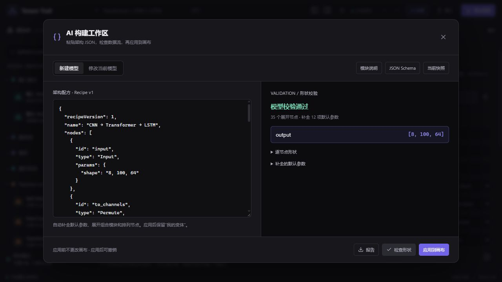

# AI 操作指南

本版提供纯 JavaScript/TypeScript API、命令行和 `window.tensorTrail` 画布 API。外部 AI 负责理解架构并生成 JSON，程序共用原有模块注册表进行构建和形状校验。无需在本程序中配置模型密钥。

**尚未提供 MCP、HTTP REST 服务或内置大模型聊天框。** 当前仅做形状推导，不运行真实张量、训练或 PyTorch 前向。普通聊天模型需由具备文件、命令行或页面调用能力的工具连接程序。

## 快速开始

在 app/ 中执行。已安装依赖可跳过 npm ci。

```sh
npm ci
npm run build:agent
node scripts/agent.mjs describe
node scripts/agent.mjs schema recipe
node scripts/agent.mjs build examples/cnn-transformer.recipe.json --out model.json
node scripts/agent.mjs validate model.json
node scripts/agent.mjs patch model.json examples/swiglu.patch.json --out swiglu-model.json
```

用网页“导入”按钮打开生成的 model.json；或点击 **AI 构建**，粘贴 Recipe，依次“检查形状”“应用到画布”。“修改当前模型”接收 Patch，整批作为一次操作，可一次撤销。面板新建时保留“我的变体”。

面板可下载模块目录、JSON Schema、当前快照和验证报告。快照包装为 `{apiVersion, revision, project}`，CLI validate/patch 与普通文件导入需要其中的 project 正文，不接受整个快照对象。



## Recipe v1

```json
{
  "recipeVersion": 1,
  "name": "我的 Transformer",
  "nodes": [
    { "id": "input", "type": "Input", "params": { "shape": "8, 100, 64" } },
    { "id": "encoder", "type": "Transformer", "params": { "d_model": 64, "heads": 8, "d_ff": 128 } },
    { "id": "output", "type": "Output" }
  ],
  "connections": [["input.out", "encoder.in"], ["encoder.out", "output.in"]]
}
```

- recipeVersion 可省略，默认 1。name、nodes、connections 必填。
- type 使用模块目录的准确名称，大小写敏感。label 为可选显示名称。id 在同一图中唯一，允许 1–100 个字母、数字、下划线和连字符；禁止 __proto__、constructor、prototype。
- 端点为 `节点ID.端口ID`。通常为 in/out；Add、Mul、MatMul 为 a/b → out；LSTM 有 out/hidden/cell。以目录为准。
- params 可省略，缺失值取注册表默认值并列入 defaultsApplied；不会根据上游尺寸自动改通道数或 d_model。未知字段、未知参数、非法类型/范围/枚举会被拒绝。
- 自动生成位置和组合模块内部子图，输出完整项目仍为 schemaVersion: 1。顶层至少一个 Input 和 Output；必需输入必须连接，禁止环路、悬空端点和同一输入端口多条边。
- Input.shape 是逗号分隔文本。默认 axes 适用于三维 [batch, sequence, feature]；其他维度明确指定 axes，或设 `axes: ""` 自动命名。符号尺寸如 `B, T, 64` 可能产生尚不能确认的约束警告。
- Transformer 默认 [B,T,D]，Conv1d 为 [B,C,L]，通常用 Permute 转换。完整示例见 app/examples/cnn-transformer.recipe.json。

## API 与返回结果

源码入口 app/src/agent/index.ts，构建后的 ESM 入口 app/dist-agent/tensor-trail-agent.js，不依赖 React、DOM 或 localStorage。修改注册表后重新 build:agent；构建产物不提交。

```js
import { describeModules, getSchemas, buildModel, validateModel, patchModel }
  from './dist-agent/tensor-trail-agent.js';
const catalog = describeModules();   // 默认不含内部边界模块
const all = describeModules(true);   // 包括 Block、Inlet、Outlet
const schemas = getSchemas();        // recipe / patch，Draft 2020-12
const draft = buildModel(recipe);
const checked = validateModel(draft.project); // 也接受 Recipe
const changed = patchModel(draft.project, patch);
```

构建、验证、修改只生成草稿，没有文件或画布副作用。

| 字段 | 含义 |
| --- | --- |
| apiVersion | 当前为 1 |
| ok | 没有 error 为 true；warning 不会使其为 false |
| diagnostics | code、severity、path、message；参数错误另有 parameter |
| nodes | 各层级节点的 path、type、status、inputs、outputs |
| outputs | 按顶层 Output 节点 ID 索引的最终 TensorSpec |
| defaultsApplied | 补全的 path、parameter、value；只计 Recipe 显式节点，不重复计算生成的内部算子 |
| project | 完整可导入项目；结构错误时可能没有此字段 |

结构合法但形状不正确时仍返回 project 供继续修改；不要仅看 project 存在就应用。诊断路径如 `["encoder", "attention", "q"]` 定位 Q 投影；入口约束失败时可能停在组合模块路径，内部推导尚未发生。

| 常见 code | 处理方式 |
| --- | --- |
| UNKNOWN_MODULE / UNKNOWN_PARAMETER | 查询模块目录，修正名称 |
| INVALID_PARAMETER | 修正类型、范围或枚举 |
| STRUCTURE_ERROR / INVALID_ENDPOINT | 检查节点、端口、重复连接和环路 |
| SHAPE_ERROR / UPSTREAM_BLOCKED | 根据 path 修正形状或先修复上游 |
| MISSING_INPUT / MISSING_OUTPUT | 补齐顶层输入输出 |
| SHAPE_WARNING | 保留并解释不能验证的符号约束 |
| CUSTOMIZED_COMPOSITE | 用 path 修改内部算子 |
| REVISION_CONFLICT | 重新读取最新模型并重做修改 |
| WARNINGS_REQUIRE_ACK | 检查警告后显式允许应用 |
| LIMIT_EXCEEDED | 缩小模型或操作批次 |

## Patch v1

```json
{
  "patchVersion": 1,
  "operations": [
    { "op": "set_params", "id": "encoder", "params": { "norm": "RMSNorm", "ffn": "SwiGLU" } },
    { "op": "rename_node", "id": "encoder", "label": "我的 Transformer" }
  ]
}
```

| 操作 | 必填字段 | 作用 |
| --- | --- | --- |
| add_node | node | 按 Recipe 节点格式新增 |
| remove_node | id | 删除节点及关联边；保护 Inlet/Outlet |
| set_params | id, params | 合并参数；未手工修改的组合模块重新生成 |
| rename_node | id, label | 修改显示名 |
| connect / disconnect | from, to | 连接/断开 node.port 端点 |
| layout | 无 | 重排目标图 |
| rename_project | name | 修改项目名 |

patchVersion 可省略，默认 1。除 rename_project 外，每项都可传 `path: ["encoder", "attention"]` 指定子图，省略为顶层，id 相对于该子图。

```json
{
  "operations": [
    { "op": "set_params", "path": ["encoder", "attention"], "id": "q", "params": { "in_features": 64, "out_features": 64 } }
  ]
}
```

内部语义编辑会标记所有祖先 customized，之后父级 set_params 拒绝重建，保护手工结构；应继续改内部算子。重命名和布局不会触发标记。

整批操作作用于克隆模型，最后统一检查，允许断开旧边、插入节点、重新连线。失败不会改变源模型。新增节点自动重排所在图，其他情形可追加 layout。Patch 保留 variants；build 新项目 variants 为空。

本版没有 replace_node，可在同批次 remove_node、add_node 并恢复连线。Inlet/Outlet 不可删除；完整改变边界时可创建新的组合模块。

## 自定义组合和新算子

Recipe 的 Block 必须提供 subgraph；内置组合模块也可显式覆盖 subgraph，都会标记 customized。子图仍为 nodes/connections，至少有一个 Inlet 和一个 Outlet。

```json
{
  "id": "my_block", "type": "Block", "label": "我的归一化模块",
  "subgraph": {
    "nodes": [
      { "id": "input", "type": "Inlet", "params": { "port": "in" } },
      { "id": "norm", "type": "RMSNorm", "params": { "features": 64 } },
      { "id": "output", "type": "Outlet", "params": { "port": "out" } }
    ],
    "connections": [["input.out", "norm.in"], ["norm.out", "output.in"]]
  }
}
```

Inlet.params.port 定义外部输入端口，内部输出为 out；Outlet.params.port 定义外部输出端口，内部输入为 in。同图同方向边界端口必须唯一。

协议只组合已注册模块，不执行传入代码。RoPE、GQA 等新算子先在 src/modules/ 增加定义和形状规则，再注册并重新构建；目录与 Schema 自动更新。视觉效果通过 src/views/ 扩展。

## 操作当前画布

以下用于有页面 JavaScript 调用能力的工具适配器或开发者工具。

```js
const api = window.tensorTrail;
const snapshot = api.getModel();
const draft = api.patchModel(snapshot.project, {
  operations: [{ op: 'rename_project', name: 'AI 搭建的模型' }]
});
if (draft.ok && !draft.diagnostics.some(d => d.severity === 'warning')) {
  const applied = api.applyModel({
    project: draft.project,
    expectedRevision: snapshot.revision
  });
  console.log(applied.ok, applied.diagnostics);
}
```

画布 API 同时提供 describeModules、getSchemas、buildModel、validateModel。getModel 返回独立快照和不透明 revision；任意模型变更、撤销重做、导入或页面刷新都会改变 revision。applyModel 必须带读取时的 revision；冲突时重新读模型并重做修改，不能给旧草稿换新 revision 绕过检查。

有警告时须检查后显式传 `allowWarnings: true`。成功应用进入原有自动保存与历史，清空重做记录、回到顶层，可一次撤销。直接 API 应用使用完整 project，包含 variants；新建时想保留变体，先把 snapshot.project.variants 赋给草稿再 validate。UI 面板已处理。

**CLI 只操作文件，不会自动改变打开的网页。** 生成文件需要导入，或调用页面 API。没有远程写入端口；后续 MCP 适配层可包装同一套函数，复用推导规则。

## CLI 约定与限制

- describe 支持可选模块类型和 --internal；schema 支持 recipe/patch，省略则输出两份。
- build 接收 Recipe；validate 接收 Recipe 或完整项目；patch 接收完整项目与 Patch。build/patch 可用 --out 写出。
- `-` 代替一个输入文件表示 stdin，至多一个 stdin 输入。
- stdout 是单个 JSON；自动化直接调用 node，npm run agent 会混入 npm 日志。
- 退出码 0 为成功/无 error，1 为协议或模型校验失败，2 为命令参数、读写或 JSON 语法错误。
- --out 只在 ok:true 时写出完整 project，不写报告包装。默认拒绝覆盖，--force 显式允许覆盖；校验失败即使 force 也不写文件。warning 模型可导出，画布应用另需确认警告。
- 输出父目录应已存在。CLI 不联网、不调用大模型、不执行传入代码。
- JSON 最多 3 MB，项目含展开子图及 variants 合计最多 2000 节点，每图最多 8000 边，嵌套最多 12 层，Patch 为 1–500 个操作。
- Schema 校验字段；跨节点、深度、总量和数学约束由运行时验证。形状检查不代表训练或显存可行性验证。

## 可直接交给 AI 的指令

```text
为 Tensor Trail 搭建模型。
1. 先读本指南，用 describe 和 schema 查询真实模块；不要虚构 type、参数或端口。
2. 整理架构的输入尺寸、轴顺序、参数、分支和残差；缺失信息明确列出假设。
3. 生成 Recipe v1，包含 Input/Output 和稳定英文 ID；非自定义模块不手写子图和位置。
4. 调用 build，读取 diagnostics/defaultsApplied/nodes/outputs，修复错误并重新检查。
5. 修改现有模型先读取 project，再用 Patch；customized 模块深入内部修改。
6. CLI 输出文件；浏览器应用使用原快照 revision，冲突后重新读取并重做修改。
7. 报告最终尺寸、假设和警告，不声称执行了训练或 PyTorch 前向。
```

## 开发验证

```sh
npm test
npm run build
npm run test:cli
```

测试覆盖混合网络、自动展开、深层诊断、自定义 Block、非法参数/连接、资源限制、原子修改、祖先保护、版本冲突和警告。store 测试覆盖一次撤销、变体保留与持久化；CLI 冒烟覆盖 stdin、退出码和失败时文件不变。

背景见 [架构方案](架构方案.md)；人工编辑和视图扩展见 [使用与扩展](使用与扩展.md)。
