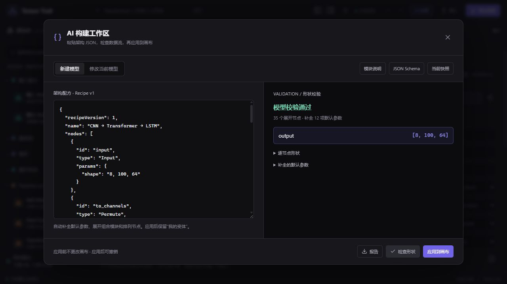

# AI 操作指南

本版提供纯 JavaScript/TypeScript API、命令行和 `window.tensorTrail` 画布 API。外部 AI 负责理解架构并生成 JSON，程序共用原有模块注册表进行构建和形状校验。无需在本程序中配置模型密钥。

**尚未提供 MCP、HTTP REST 服务或内置大模型聊天框。** 当前仅做形状推导，不运行真实张量、训练或 PyTorch 前向。普通聊天模型需由具备文件、命令行或页面调用能力的工具连接程序。

## 快速开始

在项目根目录执行。依赖统一从根锁文件安装；本机也可用 `node scripts/npm.cjs` 替代 npm。

```sh
npm ci
npm run build:agent
node packages/cli/scripts/agent.mjs describe
node packages/cli/scripts/agent.mjs schema recipe
node packages/cli/scripts/agent.mjs build examples/cnn-transformer.recipe.json --out model.json
node packages/cli/scripts/agent.mjs validate model.json
node packages/cli/scripts/agent.mjs patch model.json examples/swiglu.patch.json --out swiglu-model.json
```

用网页“打开”按钮打开生成的 model.json；或点击 **AI 构建**，粘贴 Recipe，依次“检查形状”“应用到画布”。“修改当前模型”接收 Patch，整批作为一次操作，可一次撤销。面板新建时保留“我的变体”。

面板可下载模块目录、JSON Schema、当前快照和验证报告。快照包装为 `{apiVersion, revision, project}`，CLI validate/patch 与普通文件导入需要其中的 project 正文，不接受整个快照对象。



## Recipe v1

```json
{
  "recipeVersion": 1,
  "name": "我的 Transformer",
  "nodes": [
    { "id": "input", "type": "Input", "params": { "shape": "8, 100, 64" } },
    { "id": "encoder", "type": "Transformer", "params": { "d_model": 64, "heads": 8, "d_ff": 128 } },
    { "id": "output", "type": "Output" }
  ],
  "connections": [["input.out", "encoder.in"], ["encoder.out", "output.in"]]
}
```

- recipeVersion 可省略，默认 1。name、nodes、connections 必填。
- type 使用模块目录的准确名称，大小写敏感。label 为可选显示名称。id 在同一图中唯一，允许 1–100 个字母、数字、下划线和连字符；禁止 __proto__、constructor、prototype。
- 端点为 `节点ID.端口ID`。通常为 in/out；Add、Mul、MatMul 为 a/b → out；LSTM 有 out/hidden/cell。以目录为准。
- params 可省略，缺失值取注册表默认值并列入 defaultsApplied；不会根据上游尺寸自动改通道数或 d_model。未知字段、未知参数、非法类型/范围/枚举会被拒绝。
- 自动生成位置和组合模块内部子图，输出完整项目仍为 schemaVersion: 1。节点可提供 `position: {x,y}`，两者必须为有限数值；未指定的位置自动安排。默认严格模式要求顶层至少一个输入（Input 或 ForwardInput）和 Output，必需输入必须连接；草稿模式允许尚未补齐这些部分。两种模式都禁止环路、悬空端点和同一输入端口多条边。
- Input.shape 是逗号分隔文本。默认 axes 适用于三维 [batch, sequence, feature]；其他维度明确指定 axes，或设 `axes: ""` 自动命名。符号尺寸如 `B, T, 64` 可能产生尚不能确认的约束警告。
- Transformer 默认 [B,T,D]，Conv1d 为 [B,C,L]，通常用 Permute 转换。完整示例见 examples/cnn-transformer.recipe.json。

### Q/K/V 三输入注意力

`MultiheadAttention` 提供 `q`、`k`、`v` 三个输入和 `out` 输出。参数为 `d_model`（Q 与输出特征宽度，默认 64）、`heads`（默认 8）、`kdim`、`vdim`（默认 0 表示跟随 d_model）、`causal`（默认 false）。Q/K/V 是投影前输入，模块内部包含各自的线性投影。

Q `[B,Tq,d_model]`、K `[B,Tk,kdim]`、V `[B,Tk,vdim]`，输出 `[B,Tq,d_model]`；三路 batch 和浮点 dtype 必须一致，K/V 序列长度必须相同。Q 长度可独立变化。连接相同来源可做自注意力，连接不同来源可做交叉注意力。`causal` 标记按序列索引屏蔽未来位置，未实现外部 mask 或 KV Cache 位置偏移。

示例 `examples/cross-attention.recipe.json` 展示不同序列长度与 K/V 特征宽度：

```sh
node packages/cli/scripts/agent.mjs describe MultiheadAttention
node packages/cli/scripts/agent.mjs build examples/cross-attention.recipe.json --out cross-attention.json
node packages/cli/scripts/agent.mjs validate cross-attention.json
```

配方中的连接为 `query.out → attention.q`、`key.out → attention.k`、`value.out → attention.v`、`attention.out → output.in`。展开诊断路径 `attention/q_heads`、`attention/k_heads`、`attention/v_heads` 和 `attention/scores` 可观察多头与矩形注意力分数形状。缺失任一路输入或尺寸不兼容会阻断输出。

## Forward 输入

### if 条件范围框

`IfRegion` 是画布中的虚线范围框，不是函数或执行引擎。`condition` 写条件表达式（不含 `if` 和冒号），`members` 为同层节点 ID 的逗号分隔文本，`note` 为说明。条件只显示，不执行 Python、不改变数据边或推导顺序；所有内部形状均为静态检查，不表示两个条件同时成立。示例参数：`{"condition":"self.pretrain","members":"cast,normalize,match,set","note":"预训练时每次 forward 刷新分组"}`。

范围根据成员节点的实际尺寸自动计算，不改变旧节点位置或连线。画布多选节点后点击工具栏「if 框」；也可从库拖入空框，在右侧勾选成员。通过移动内部节点调整范围；非空框自身不整体拖动。删除框保留内部节点，复制框包含内部节点；当前不允许同层范围重叠或把范围框再作为成员，嵌套条件可放到函数子图中。API 使用普通 `add_node` / `set_params` 操作，无需直接编辑项目 JSON。

同一模块属性有多次赋值时，`SetAttribute` / `GetAttribute` 可设置 `version`，例如 `initial` 和 `pretrain`。每次 SET 使用不同版本，GET 显式选版本。它们仍然表示同一个 Python 属性，不是两个属性或参数；版本只消除静态绑定歧义，不模拟条件、执行顺序或最终状态。未写版本的旧单次赋值保持兼容。

`ForwardInput` 无输入端口，输出端口为 `out`。画布以简单矩形显示 `label`，默认“Forward输入”；无需填写形状。参数 `text` 是可选备注（默认空字符串，最多 1999 字符），保存在右侧属性中，不在画布另加内容框。示例为 `examples/structured-input.recipe.json`。

结果中的 `ValueSpec`：Tensor 保持 `{shape, axes, dtype}`；Forward 输入为 `{kind: "forward", text}`。读取形状前需判断 `"shape" in value`。Forward 输入可通过 Identity、Output 和自定义子图边界传递，直接连接张量算子会报告类型错误。

旧项目和旧 Recipe 中的 `DictInput`、`ListInput` 兼容转换为 `ForwardInput`，模块目录和新 Schema 只公开 ForwardInput。转换保留自定义名称、备注与连线；旧默认名称改为“Forward输入”。

`node packages/cli/scripts/agent.mjs build examples/structured-input.recipe.json --out forward-input.json`

## 切片与计算模块

模块目录新增 `Slice` 和 `Compute`，Input.dtype 新增 `bool`。原有 `Concat` 的类型和 a/b 端口不变，界面名称及图形为圆形 Cat。

- `Slice` 的参数为 `dim`（默认 -1）、`start`（默认空字符串）、`stop`（默认字符串 "2"）、`step`（默认 1 的正整数）。边界以字符串传入，空字符串表示对应端点省略；默认对应 `[..., :2]`。
- `Compute.params.operations` 是 JSON 数组序列化后的字符串，必须有 1–16 步。各步为 `{"op":"invert"}`、`{"op":"any","dim":null,"keepdim":false}` 或 `{"op":"slice","dim":-1,"start":"","stop":"2","step":1}`。不接受任意函数名或代码。
- `invert` 只接受 bool/int64，保持形状；`any` 输出 bool，dim=null 归约全部轴，dim 为整数则只归约指定轴。keepdim=true 将被归约轴保留为长度 1，否则删除这些轴，全部删除后形状为标量 `[]`。
- 所有运算仍为形状和类型推导，不执行 PyTorch 或数值计算。组合中的错误会注明失败步骤；原模型和画布在应用前保持不变。

完整示例为 `examples/calculation.recipe.json`，可以直接 build、validate 并在网页导入；其中输出应为 `[2,3]`、dtype 为 bool。网页逐轴编辑仍序列化为 Input.params.axes 的逗号分隔文本，旧 Recipe 保持兼容。

### 序列读取与已有权重

`TensorSequenceGet` 用 `in → out` 读取 Tensor 的 list/tuple 元素；`index` 是整数表达式字符串（默认 `"0"`，支持负索引）。例如 `mlvl_feats[0]` 返回完整的 `[B,N,C,H,W]` Tensor，不移除 batch 轴，也不执行 TensorIndex 或 stack。空序列、越界和非 Tensor 序列均报错；已有梯度标注原样保留。

`LearnedParameter` 新增 `initialization`（默认 `"normal_0.02"`，保持旧模型行为）与 `source_note`。用 `initialization: "existing"` 表示读取已有 `nn.Parameter`，如 `self.init_points.weight`；在备注里记录实际构造和初始化来源。不会在每次 forward 中重新随机初始化，也不是调用 Embedding 查表。仅记录规格，不虚构权重数值或运行时梯度状态。扩维和按 batch 复制可继续连接 `Unsqueeze` 与带动态整数端口的 `Repeat`。

`EmbeddingXYZInit` 是可展开的 **构造阶段说明**，不是 forward 调用：`EmbeddingWeight` 创建 `nn.Embedding(Q,3)` 并展示注册的 `.weight`；两个 `UniformInitColumns` 原地初始化 x 为 U(0,1.1)、y/z 为 U(0,1)。端口返回完整权重状态，不把模块对象伪装成 Tensor，也不新增参数副本。输出的 `requires_grad` 来自构造声明（默认 true，来源为静态推导），不是运行采集或已存在梯度值；加载 checkpoint 可覆盖初始数值。真实冻结时应修改声明或使用运行快照。初始化内部的 no_grad 不改变参数本身的 requires_grad。

建议背景继续只表示梯度状态；蓝色边框 `#60a5fa` 配合 `Parameter` 名称标识模型权重，扩维/复制结果仍是普通 Tensor，不继承“模型参数”的身份。`set_tensor_border` 可通过 API 应用此约定，颜色本身不改变数值或梯度语义。

## API 与返回结果

源码入口 packages/model-core/src/agent/index.ts，构建后的 ESM 入口 packages/model-core/dist/tensor-trail-agent.js，不依赖 React、DOM 或 localStorage。修改注册表后重新 build:agent；构建产物不提交。

```js
import { describeModules, getSchemas, buildModel, validateModel, patchModel }
  from './packages/model-core/dist/tensor-trail-agent.js';
const catalog = describeModules();   // 默认不含内部边界模块
const all = describeModules(true);   // 包括 Block、Inlet、Outlet
const schemas = getSchemas();        // recipe / patch，Draft 2020-12
const draft = buildModel(recipe);
const checked = validateModel(draft.project); // 也接受 Recipe
const changed = patchModel(draft.project, patch);
```

构建、验证、修改只生成草稿，没有文件或画布副作用。

| 字段 | 含义 |
| --- | --- |
| apiVersion | 当前为 1 |
| mode | 本次校验模式：strict 或 draft，不写入项目文件 |
| ok | 没有 error 为 true；warning 不会使其为 false |
| diagnostics | code、severity、path、message；参数错误另有 parameter |
| nodes | 各层级节点的 path、type、status、inputs、outputs |
| outputs | 按顶层 Output 节点 ID 索引的最终 TensorSpec |
| defaultsApplied | 补全的 path、parameter、value；只计 Recipe 显式节点，不重复计算生成的内部算子 |
| project | 完整可导入项目；结构错误时可能没有此字段 |

结构合法但形状不正确时仍返回 project 供继续修改；不要仅看 project 存在就应用。诊断路径如 `["encoder", "attention", "q"]` 定位 Q 投影；入口约束失败时可能停在组合模块路径，内部推导尚未发生。

| 常见 code | 处理方式 |
| --- | --- |
| UNKNOWN_MODULE / UNKNOWN_PARAMETER | 查询模块目录，修正名称 |
| INVALID_PARAMETER | 修正类型、范围或枚举 |
| STRUCTURE_ERROR / INVALID_ENDPOINT | 检查节点、端口、重复连接和环路 |
| SHAPE_ERROR / UPSTREAM_BLOCKED | 根据 path 修正形状或先修复上游 |
| MISSING_INPUT / MISSING_OUTPUT | 补齐顶层输入输出 |
| INCOMPLETE_NODE | 草稿中的未连接节点及其依赖；未推导出输出，不伪造张量 |
| RUNTIME_NOT_LOADED | 草稿仅检查静态图；运行快照未加载，原引用仍保留 |
| SHAPE_WARNING | 保留并解释不能验证的符号约束 |
| CUSTOMIZED_COMPOSITE | 用 path 修改内部算子 |
| REVISION_CONFLICT | 重新读取最新模型并重做修改 |
| WARNINGS_REQUIRE_ACK | 检查警告后显式允许应用 |
| LIMIT_EXCEEDED | 缩小模型或操作批次 |

## Patch v1

```json
{
  "patchVersion": 1,
  "operations": [
    { "op": "set_params", "id": "encoder", "params": { "norm": "RMSNorm", "ffn": "SwiGLU" } },
    { "op": "rename_node", "id": "encoder", "label": "我的 Transformer" }
  ]
}
```

| 操作 | 必填字段 | 作用 |
| --- | --- | --- |
| add_node | node | 按 Recipe 节点格式新增 |
| replace_node | id, node | 原子替换同一 ID 的类型与参数；保留默认位置，完整事务须修复受影响端口 |
| remove_node | id | 删除节点及关联边；保护 Inlet/Outlet |
| set_params | id, params | 合并参数；未手工修改的组合模块重新生成 |
| rename_node | id, label | 修改显示名 |
| set_position | id, position | 仅移动指定节点，position 为有限 x/y；不触发祖先 customized |
| set_tensor_border | id, color | 设置本节点边框（`#RRGGBB`）；`null` 恢复默认，不改背景、梯度或布局，关联副本仅改本地颜色 |
| connect / disconnect | from, to | 连接/断开 node.port 端点 |
| layout | 无 | 重排目标图 |
| rename_project | name | 修改项目名 |

patchVersion 可省略，默认 1。除 rename_project 外，每项都可传 `path: ["encoder", "attention"]` 指定子图，省略为顶层，id 相对于该子图。

```json
{
  "operations": [
    { "op": "set_params", "path": ["encoder", "attention"], "id": "q", "params": { "in_features": 64, "out_features": 64 } }
  ]
}
```

内部语义编辑会标记所有祖先 customized，之后父级 set_params 拒绝重建，保护手工结构；应继续改内部算子。重命名和布局不会触发标记。

整批操作作用于克隆模型，最后统一检查，允许断开旧边、插入节点、重新连线。失败不会改变源模型。Patch 默认保留已有布局，仅安排未指定 position 的新节点；显式 layout 操作仍重排目标图。第三参数 `{layout: 'auto'}` 恢复添加节点后重排所在图的旧行为。Patch 保留 variants；build 新项目 variants 为空。

## 草稿与保留布局

适用于 SparseWorld 等按代码逐段补图的流程。校验策略是一次调用的选项，不改变静态图的 schema，也不把草稿当成完整模型。

```js
buildModel(recipe, { mode: 'draft' });
validateModel(project, { mode: 'draft' });
patchModel(project, patch, { mode: 'draft', layout: 'preserve' });
```

- `mode` 默认 `strict`，可选 `draft`。草稿允许缺少顶层输入/输出、尚未连接的输入，以及仅由这些缺失造成的下游阻塞；诊断为 warning，节点 trace 标为 incomplete，不生成虚假的输出。
- 环路、重复 ID、错误端口、未知模块/参数、已知形状或 dtype 错误始终是 error。`ok: true` 在 draft 下仅表示可继续编辑，不表示模型完整或可训练。
- 子图仍必须有合法边界。逐步展开请用 `Submodule`，至少保留一个 Inlet，可以暂不定义 Outlet；不要为了通过校验伪造返回值。
- `layout` 默认 `preserve`。旧节点位置、端口布局、现有连线拐点和标签位置不动；新节点有 position 时直接使用，否则确定性地放到已有布局右侧。生成式组合模块改参数后，保留仍存在的节点/连线几何信息。
- `set_position` 只移动指定节点；不会替它重画手工连线，也不将祖先标成 customized。显式 `layout` 操作优先于保留布局；`layout: 'auto'` 会在添加节点的子图中重排。
- 原地修改的节点、连线和参数使用 Patch；不必手工编辑持久化 JSON。只有模块目录没有对应语义时才实现新的算子、形状规则并重新构建。

CLI 对应命令：

```sh
node packages/cli/scripts/agent.mjs validate ../SparseWorld.tensor-trail.json --draft
node packages/cli/scripts/agent.mjs patch ../SparseWorld.tensor-trail.json examples/sparseworld-incremental.patch.json --draft --layout preserve --out ../SparseWorld.preview.tensor-trail.json
node packages/cli/scripts/agent.mjs schema patchOptions
```

示例 Patch 仅在 `extract_feat` 子图添加 `img_normalized_copy` 展示节点，并连接 `img_after_normalize.out`，不添加新的模型计算。重复应用同一 ID 会被拒绝。`--out` 只在所选模式下无 error 时写出；覆盖现有文件仍需显式 `--force`。CLI 不会同步已经打开的桌面画布，文件写出后需重新打开。

画布 API 可以即时应用并一次撤销，仍必须使用最新 revision 并确认 warning：

```js
const api = window.tensorTrail;
const snapshot = api.getModel();
const changed = api.patchModel(snapshot.project, patch, {
  mode: 'draft', layout: 'preserve',
});
// 先阅读 changed.diagnostics；确认所有提示后再执行：
if (changed.ok) {
  api.applyModel({
    project: changed.project,
    expectedRevision: snapshot.revision,
    mode: 'draft',
    allowWarnings: true,
  });
}
```

界面的“AI 构建”也提供“草稿模式”和“保留已有布局”开关；修改开关会使上次预览失效，需要重新检查。“应用”只修改画布，保存仍沿用当前文件流程。

运行快照和静态图继续分离。独立 SDK/CLI 不自动读取侧边文件；草稿缺少活动快照时给出 `RUNTIME_NOT_LOADED`，仅对临时副本使用静态推导，返回的项目保留原 active/snapshots 引用。严格模式仍报错。SDK 可传 `{mode: 'draft', runtimeSnapshot: loadedSnapshot}`，画布 API 自动使用已加载的运行快照，不把它嵌回主 JSON。提供了无效或绑定失效的快照仍报错，不能以草稿模式绕过。运行快照改变也会使画布 revision 失效。

`replace_node` 可在同一事务中替换类型和参数，必须保留相同 ID；未指定位置时保留旧位置，显式端口布局与边框也保留。关联副本需先解除或移除。替换 Inlet/Outlet 时必须同步调整父图连线，否则整批拒绝；`remove_node` 仍不允许直接删除边界。示例：`{"op":"replace_node","path":["head"],"id":"scale","node":{"id":"scale","type":"GetAttribute","params":{"owner":"[\"head\"]","name":"points_scale"}}}`。

## 自定义组合和新算子

Recipe 的 Block 必须提供 subgraph；内置组合模块也可显式覆盖 subgraph，都会标记 customized。子图仍为 nodes/connections，至少有一个 Inlet 和一个 Outlet。

```json
{
  "id": "my_block", "type": "Block", "label": "我的归一化模块",
  "subgraph": {
    "nodes": [
      { "id": "input", "type": "Inlet", "params": { "port": "in" } },
      { "id": "norm", "type": "RMSNorm", "params": { "features": 64 } },
      { "id": "output", "type": "Outlet", "params": { "port": "out" } }
    ],
    "connections": [["input.out", "norm.in"], ["norm.out", "output.in"]]
  }
}
```

Inlet.params.port 定义外部输入端口，内部输出为 out；Outlet.params.port 定义外部输出端口，内部输入为 in。同图同方向边界端口必须唯一。

协议只组合已注册模块，不执行传入代码。RoPE、GQA 等新算子先在 src/modules/ 增加定义和形状规则，再注册并重新构建；目录与 Schema 自动更新。视觉效果通过 src/views/ 扩展。

## 操作当前画布

以下用于有页面 JavaScript 调用能力的工具适配器或开发者工具。

```js
const api = window.tensorTrail;
const snapshot = api.getModel();
const draft = api.patchModel(snapshot.project, {
  operations: [{ op: 'rename_project', name: 'AI 搭建的模型' }]
});
if (draft.ok && !draft.diagnostics.some(d => d.severity === 'warning')) {
  const applied = api.applyModel({
    project: draft.project,
    expectedRevision: snapshot.revision
  });
  console.log(applied.ok, applied.diagnostics);
}
```

画布 API 同时提供 describeModules、getSchemas、buildModel、validateModel。getModel 返回独立快照和不透明 revision；任意模型变更、撤销重做、导入或页面刷新都会改变 revision。applyModel 必须带读取时的 revision；冲突时重新读模型并重做修改，不能给旧草稿换新 revision 绕过检查。

有警告时须检查后显式传 `allowWarnings: true`。成功应用进入当前会话的编辑历史，需使用 Ctrl+S 保存到文件，清空重做记录、回到顶层，可一次撤销。直接 API 应用使用完整 project，包含 variants；新建时想保留变体，先把 snapshot.project.variants 赋给草稿再 validate。UI 面板已处理。

**CLI 只操作文件，不会自动改变打开的网页。** 生成文件需要导入，或调用页面 API。没有远程写入端口；后续 MCP 适配层可包装同一套函数，复用推导规则。

## CLI 约定与限制

- describe 支持可选模块类型和 --internal；schema 支持 recipe/patch，省略则输出两份。
- build 接收 Recipe；validate 接收 Recipe 或完整项目；patch 接收完整项目与 Patch。build/patch 可用 --out 写出。
- `-` 代替一个输入文件表示 stdin，至多一个 stdin 输入。
- stdout 是单个 JSON；自动化直接调用 node，npm run agent 会混入 npm 日志。
- 退出码 0 为成功/无 error，1 为协议或模型校验失败，2 为命令参数、读写或 JSON 语法错误。
- --out 只在 ok:true 时写出完整 project，不写报告包装。默认拒绝覆盖，--force 显式允许覆盖；校验失败即使 force 也不写文件。warning 模型可导出，画布应用另需确认警告。
- 输出父目录应已存在。CLI 不联网、不调用大模型、不执行传入代码。
- JSON 最多 3 MB，项目含展开子图及 variants 合计最多 2000 节点，每图最多 8000 边，嵌套最多 12 层，Patch 为 1–500 个操作。
- Schema 校验字段；跨节点、深度、总量和数学约束由运行时验证。形状检查不代表训练或显存可行性验证。

## 可直接交给 AI 的指令

```text
为 Tensor Trail 搭建模型。
1. 先读本指南，用 describe 和 schema 查询真实模块；不要虚构 type、参数或端口。
2. 整理架构的输入尺寸、轴顺序、参数、分支和残差；缺失信息明确列出假设。
3. 生成 Recipe v1，包含 Input/Output 和稳定英文 ID；非自定义模块不手写子图和位置。
4. 调用 build，读取 diagnostics/defaultsApplied/nodes/outputs，修复错误并重新检查。
5. 修改现有模型先读取 project，再用 Patch；customized 模块深入内部修改。
6. CLI 输出文件；浏览器应用使用原快照 revision，冲突后重新读取并重做修改。
7. 报告最终尺寸、假设和警告，不声称执行了训练或 PyTorch 前向。
```

## 图像尺寸与元数据旁路

`TensorShapeSlice` 接收 `in: Tensor`，参数 `start="-2"`、`end=""` 对应
`img.shape[-2:]`；输出 `out` 是 `{kind:"size", dims:[H,W]}`，界面显示为
`torch.Size([H,W])`，不是 Tensor，不带梯度状态。可接 `ValueVariable` 命名为 `input_shape`。

`UpdateImageMetaInputShape` 接收 `img_metas` 和 `input_shape` 两个端口，表示
`for img_meta in img_metas: img_meta.update(input_shape=input_shape)`。
`img_metas` 使用 `ForwardInput` 的不透明占位或已有列表说明；`input_shape` 必须为两个尺寸的
`torch.Size`。输出 `out` 是原列表更新后的状态说明，不是新 Tensor 或新 Python 列表。
右侧显示已知字段更新，其他字段与列表长度不做推测；这不是完整元数据采集或 Python 执行器。
两个模块可通过草稿模式 API 添加，修改上游图像尺寸会重新推导 H、W。

## ResNet-50 命名模块

`CodeFunction` 的 `operation="ResNet50Backbone"` 对应 SparseWorld 当前的固定
MMDetection ResNet-50 配置。输入端口 `in` 为浮点 NCHW 图像；`c2/c3/c4/c5`
分别表示实际返回 tuple 的 `img_feats[0]/[1]/[2]/[3]`，可连接四个 `TensorVariable`。
这只是将 tuple 元素分别展示，并非四次 backbone 调用或额外张量堆叠。

通道分别为 256/512/1024/2048，总步长分别为 4/8/16/32，空间大小按向上取整推导。
模板只显示网络名称及输入输出契约，不展开 ResNet 内部，也不执行 Python。
右侧代码注明 `use_grid_mask=False` 和 tuple 不触发字典转列表的当前路径。
FPN 与后续 batch/view 恢复不属于这个模块；输出梯度状态不凭参数可训练性推测。

## FPN 子图与二维插值

FPN 可通过 API 用 `Submodule`、`Conv2d`、`Add` 和 `CodeFunction` 组合，不需要单独硬编码 FPN 输出。
`operation="Interpolate2DNearest"` 接收 `in` 与 `like` 两路 NCHW Tensor，输出为
`F.interpolate(in, size=like.shape[2:], mode="nearest")`；只从 `like` 读取高宽，源 N/C/dtype 保留。
不要替换为固定放大两倍，奇数高宽需要精确对齐；这个节点不负责相加。

SparseWorld 当前 FPN 为四路 1x1 lateral 卷积，三次从粗到细的最近邻插值与 Add，
以及四路 3x3/padding=1 输出卷积；通道均为 256，无 BN、激活或额外金字塔层。
下一次上采样接前一次 Add 的结果，而不是未融合的 lateral 或最终 3x3 输出。
子模块的 c2-c5/p2-p5 端口分别展示输入/输出 tuple 元素，不表示四次 FPN 调用。

## tuple/list 返回值与空列表

`TensorSequencePack` 用 `kind="tuple"` 或 `"list"`、`input_count=0..16` 配置容器。
输入端口为 `item0`、`item1` 等，输出 `out` 是保留各元素 shape/dtype/梯度标注的有序容器，
不是 Tensor，不要求元素同形，也不是 `stack` 或 `concat`。右侧观察器可查看每个元素。
将 `out` 接入 `Outlet`，父模块就通过一个端口返回整个 tuple/list，再用 `ValueVariable` 接收。
这表达已有返回值的结构，不表示源码额外复制或计算特征。

`kind="list", input_count=0` 没有输入端口，表示 `[]` 初始化，可接 `ValueVariable`。
不要从已有特征画一条虚假的输入依赖；空列表尚不包含后续循环 append 的 Tensor，
也不是形状 `[0]` 的 Tensor。容器本身没有 `requires_grad`，元素各自保留标注。
目前仅支持 Tensor 元素，不推导 Python 对象身份或 list 原地修改；不改变已有不透明 `list[dict]` 元数据。

## 关联副本与就近连接

通过 `duplicate_linked` 创建已有值节点在同一画布中的关联副本，例如：

```json
{"op":"duplicate_linked","path":["extract_feat"],"source":"B","id":"B_near_loop","position":{"x":4810,"y":100}}
```

`source` 和新 `id` 必须属于同一 `path`；若 source 本身是副本，会直接关联原始主节点，不产生引用链。
支持已有可关联值类型，例如 LocalParameter、IntegerParameter、TensorVariable 和 Inlet；不支持计算算子。
副本没有独立输入端口，不需要主节点到副本的连线；输出可就近连接消费者。
用 `disconnect/connect` 将原长线替换为副本到消费者的短线。它主要减少长线和交叉，不一定减少边的总数。
改名或改参数会同步主节点，位置独立。Inlet 副本不会增加父模块的输入端口。
循环中的副本共享当前迭代的值，不能把外层同名参数当成循环体内的尺寸值。
此操作同样支持 `mode:"draft",layout:"preserve"`，失败时整个补丁回滚；不直接编辑项目 JSON。

## ForEach 循环子图

`ForEachTensor` 将 Tensor tuple/list 的每个元素送入同一个子图，逐轮推导后按序收集为 list。
外层输入 `items` 是已知元素的 tuple/list，`initial` 是初始列表（通常由 `TensorSequencePack` 创建 `[]`）。
子图必须包含 `Inlet(port="item")` 和唯一 `Outlet(port="out")`，后者表示本轮待 append 的单个 Tensor。
可选 `Inlet(port="index")` 接收从 0 开始的整数迭代索引；其他 Inlet（例如 `B`）自动变为外层捕获端口，
各轮接收相同值。`items/initial/out` 为外层保留名，不能作为子图 Inlet。

这不是带状态的 RNN，不应将上一轮特征反馈到下一轮。初始列表不进入循环体，收集只发生在外层；
不支持 break/continue、逐轮条件过滤、修改捕获值或循环携带状态。不同迭代允许不同 shape/dtype。
空输入跳过循环体并保留初始列表。为避免静态推导膨胀，每个循环最多 16 次，收集结果最多 256 个元素，
一次完整推导最多 20000 次节点访问；这些是软件限制，不是 Python 限制。

双击进入循环体后，通过“当前迭代”选择器查看各轮的尺寸与列表长度变化。
选择器是临时视图状态，不写项目文件，不产生撤销记录，也不执行 Python。
所有迭代都会被验证，即使当前显示的是第一轮；API 的循环节点 trace 包含各轮 `iterations[index].outputs`。
子节点 trace 默认展示第一轮；桌面内部使用 `resultAt(result,path,selections)` 查看指定迭代。
草稿补图继续使用 `patchModel(...,{mode:"draft",layout:"preserve"})`。

整数尺寸模块 `IntegerTruncDivide` 的 `a/b → out` 对应 `int(a / b)`，向零截断而非向下取整，
拒绝除数 0；符号输入保留表达式并提示约束。可用于 SparseWorld 的 `BN / B`，再连接 `View` 的尺寸端口。
`View` 只验证尺寸/元素数，不验证 PyTorch stride 是否允许真正的零拷贝 view。

## While 状态循环

`WhileLoop` 展示有界循环 `while i < num_points`，每轮固定 `i += 1`。
参数 `states` 是逗号分隔的 Tensor 状态名，例如 `maps,inds`。
循环体需有 `Inlet(i)`、`Inlet(num_points)` 和每个状态的 Inlet；其余 Inlet 是只读捕获值。
循环体的 Outlet 必须恰好是 `i` 和所有状态，分别表示下一轮计数器与下一轮状态。
外层只输出各状态，不暴露循环体中的单轮 `i`。反馈由循环语义管理，不能连接普通边制造环路。

这里只推导一轮符号模板 `i`，检查输出 `i + 1` 及状态 shape/dtype 不变量，不展开 1040 个子图。
初始 i 与上界为已知整数且条件不成立时跳过循环体，原样返回状态。
不支持 break/continue、任意 while 条件、变形状状态或运行时迭代回放。
模板输出只声明循环结束时的规格，不包含真实 Tensor 数值或实际分配结果；不得标为某次真实迭代。
循环体不允许脱离 WhileLoop 保存为普通变体；可复制整个循环节点。

`IfCondition` 产生未执行的条件及 True/False 控制依赖，画为菱形和虚线。
`BranchValue` 为每条可能路径传入 Tensor，`MergeBranches` 检查两个路径的 shape/dtype 一致。
静态检查两条路径不代表 Python 同时执行两条路径，也不是 `torch.where`。
`IntegerList` 是 Python `list[int]`，不是 Tensor 列表。
`TensorItemInt` 只把标量读取表达为符号 Python 整数；float 标量须显式启用 `int(x)`，不能伪装成整数 `.item()`。

SparseWorld 示例在 `packages/model-core/tests/fixtures/matchingLoop.ts`：按 `original_id` 写入 `inds`，
用更新后的 `inds` 统计配额，配额满时仅清零、重排并写回 `maps[i+1:]`，保留已处理前缀。
使用 `patchModel(...,{mode:"draft",layout:"preserve"})` 插入子图，局部值通过 `duplicate_linked` 就近引用。

## 开发验证

```sh
npm test
npm run build
npm run test:cli
```

测试覆盖混合网络、自动展开、深层诊断、自定义 Block、非法参数/连接、资源限制、原子修改、祖先保护、版本冲突和警告。store 测试覆盖一次撤销、变体保留与持久化；CLI 冒烟覆盖 stdin、退出码和失败时文件不变。

背景见 [架构方案](架构方案.md)；人工编辑和视图扩展见 [使用与扩展](使用与扩展.md)。
