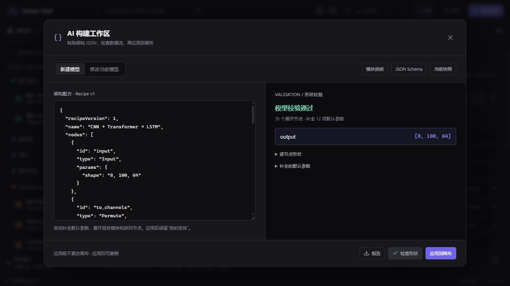

# AI 操作指南

模型绘图先按 [标准绘图风格与程序设计规范](标准绘图风格与程序设计规范.md) 与 [模型绘图规范与验收清单](模型绘图规范与验收清单.md) 确定风格样板、算子扩展要求、语义和验收方式；本文提供具体的 API 与算子操作方法。通用规范末尾包含可复用的自动绘图任务模板和交付记录模板。

本版提供纯 JavaScript/TypeScript API、命令行和 `window.tensorTrail` 画布 API。外部 AI 负责理解架构并生成 JSON，程序共用原有模块注册表进行构建和形状校验。无需在本程序中配置模型密钥。

**尚未提供 MCP、HTTP REST 服务或内置大模型聊天框。** 当前仅做形状推导，不运行真实张量、训练或 PyTorch 前向。普通聊天模型需由具备文件、命令行或页面调用能力的工具连接程序。

## 双模式绘图（1:1 源码精确模式 / 精简语义模式）

**已有 1:1 图**可用 `CalculationGroup` 折叠同一代码范围及布局分区中的连通计算。折叠后所有外部依赖仍须构成 DAG。可选的 `summary`、`formula` 各限 240 字。摘要留空时卡片列出各步，填写后双击摘要卡即可检查内部算子。Recipe 可显式提供带 Inlet/Outlet 的子图，已自定义的组合也支持通过 `set_params` 修改摘要与表达式。

**按规格直接绘图**可用叶节点 `SemanticOp`。用 `inputs`、`outputs` 填写逗号分隔的标识符，各端口列表内名称唯一。输入接受 1–12 个任意值，输出声明 1–8 个 Tensor。填写 `summary` 描述计算，可选 `formula` 用于展示。两者各限 240 个 Unicode 码点，`output_specs` 的 JSON 文本限 4000 个码点。默认继承按端口顺序遇到的首个 Tensor 的 shape、axes 和 dtype；没有 Tensor 输入时需填写 shape。显式 shape 支持整数及项目超参数算式，轴名留空时生成 axis0、axis1 等。

多输出可共用规格，或用 `output_specs` **JSON 字符串**逐端口指定，例如 `{"dist":{"shape":"B","axes":"batch"},"idx":{"shape":"B","dtype":"int64","requires_grad":false}}`。未列出的端口从首个 Tensor 继承规格。梯度选项为 auto/on/off，JSON 内也接受布尔值。on 要求浮点输出。auto 对非浮点输出或所有 Tensor 输入已知关闭梯度的情况推断为 off，其他情况保留未知。开启来源分析时每个输出记录所声明输入的来源并集。

以下分别是 `patchModel` 的单个操作，均可带当前画布的 `path`。

```json
[
  {"op":"collapse_calculations","ids":["align","zeros","where"],"id":"mask_block","summary":"按有效掩码清零","formula":"where(mask, x, 0)"},
  {"op":"expand_calculation","id":"mask_block"},
  {"op":"auto_simplify","min_size":2,"recursive":true}
]
```

自动精简优先折叠只有一个出口的胶水链，保留共享分支及分区输出。默认只处理当前画布，至少合并两步。核心函数返回新组合 ID 列表（`mergedGroups`）及画布节点净减少数（`removedNodes`）。返回 1:1 视图时，右键选择“展开语义块”。两种方法可共存于同一图，完整示例见 [双模式 Recipe](../examples/semantic-dual-mode.recipe.json)。

## 封装模块样式

Recipe 的 `Submodule` 节点可带 `submoduleVisual`，例如 `{"id":"fusion","type":"Submodule","submoduleVisual":{"icon":"cross_attention","summary":"将图像特征汇入查询"}}`。三个字段均可省略。

| 字段 | 取值与效果 |
| --- | --- |
| `icon` | `auto / backbone / attention / cross_attention / mlp / projection / encoder / decoder / head / module`。自动模式先识别模块名称，再参考内部层类型，兜底使用通用模块。 |
| `tone` | `auto / blue / violet / teal / amber / rose / slate`。自动色标随最终原型变化。 |
| `summary` | 最多 120 个 Unicode 码点，保存时去掉首尾空白。留空时从内部语义说明或关键层类型提取。 |

给已有子模块设置样式可用下例。`path` 指向父图，根图可省略。补丁整对象替换，省略的字段恢复自动；`visual: null`、空对象或全默认对象清除展示字段。检查器「封装模块样式」提供相同操作，摘要回车或失焦提交，支持撤销和重做。已手工展开的子图也可改样式，已有步骤、形状推导、坐标和路径均予以保留。

```json
{
  "operations": [{
    "op": "set_node_submodule_visual",
    "path": ["encoder"],
    "id": "fusion",
    "visual": { "icon": "cross_attention", "tone": "teal", "summary": "将图像特征汇入查询" }
  }]
}
```

## 3D/4D 张量积木

Recipe 节点的 `tensorVisual` 与 Patch 操作 `set_node_tensor_visual.visual` 使用同一套配置。CLI、`@tensor-trail/model-core/agent` 和页面的 `window.tensorTrail.patchModel` 均支持以下补丁。子图节点可加 `path`。在页面上通过 `applyModel` 和读取项目时的 revision 应用补丁。

```json
{
  "operations": [{
    "op": "set_node_tensor_visual",
    "id": "features",
    "visual": {
      "mode": "block", "color": "#3b82f6", "depthStyle": "auto",
      "width": 260, "boxWidth": 48, "boxHeight": 32, "boxDepth": 30,
      "axisLabels": ["queue", "query", "head", "dim"], "caption": "两帧查询特征"
    }
  }]
}
```

| 字段 | 取值与效果 |
| --- | --- |
| `mode` | 必填。`block` 启用积木，`off` 单独关闭。 |
| `tone`、`color` | 预设为 `auto/blue/violet/teal/amber/rose/slate`。自定义 `#RRGGBB` 优先，为三个面与轮廓生成明暗色。 |
| `depthStyle` | `auto` 对 Z ≤ 4 或沿 Z 拼接的结果显示切片，对更大或符号深度显示连续实心体。`solid` 强制实心，`slices` 强制分层。大或符号深度的切片抽样三层，并标注真实尺寸。 |
| `width` | 卡片宽 140–420 px。默认 180 px，横排多个体积时默认 220 px。 |
| `boxWidth`、`boxHeight`、`boxDepth` | 面宽 16–160、面高 12–120、挤出深度 6–72 px。深度在切片模式控制整个堆叠。省略时按图内统一尺度计算，窄卡片会缩短投影以容纳整行。 |
| `axisLabels` | 按 shape 从左到右覆盖显示名，最多 8 项，每项 1–32 个 Unicode 码点。省略的轴沿用推导名。 |
| `caption` | 卡片说明，最多 120 个 Unicode 码点。 |

对 `[W]` 显示细条，对 `[H,W]` 显示薄板，对 `[Z,H,W]` 显示一个体积。四维 `[N,Z,H,W]` 的 N 轴在水平方向展开，底部括号标出外轴名称和大小。N 为 1、2、3 时逐个绘制体积，N ≥ 4 或为符号时用省略号连接首尾两个体积。更高维仅将 `shape.slice(0,-4)` 中的轴显示为标签。

Concat 与 Stack 按实际拼接轴及输入端口顺序着色，包括外轴上的横排体积。同形的 TensorVariable、ValueVariable、Output、Outlet、Contiguous、Detach 及关联副本沿用上游色段。给变量指定颜色可将它及下游透传值显示为纯色。检查器的「TENSOR 观察」可切换端口并查看完整轴名。「张量积木」支持实时调色、切换深度样式、调整尺寸，以及用中英文逗号输入轴名。文本在回车或失焦时提交，编辑支持撤销与重做。

补丁会替换该节点的整份积木配置。保留 `mode` 并省略某个可选字段可恢复该字段的默认值，`visual:null` 恢复跟随画布。全局预览初始关闭，开启后仅为有 Tensor 规格且未配置积木或插图的值与来源节点自动显示积木，包含 Output 和 Outlet。计算算子可显式启用积木，并可同时显示 `visualMedia`。旧项目的 `operation` 模式载入为 `block`，其超宽卡片收为 420 px。重建子图时，同 ID、同类型的节点保留显示配置。

## 节点插图与 PPT 箭头

在 Recipe 节点的 `visualMedia` 或 Patch 的 `set_node_media.media` 中填写图集。每个节点独立保存 1–12 张图，图片 ID 遵循节点 ID 规则，在图集内唯一。适用于值、算子和模块卡片，布局分区和条件、循环范围框除外。

```json
{
  "patchVersion": 1,
  "operations": [
    {
      "op": "set_node_media", "id": "input",
      "media": {
        "layout": "auto", "tileWidth": 144,
        "items": [{
          "id": "mask", "caption": "筛选后保留的位置", "badge": "保留", "emphasis": "highlight",
          "src": "data:image/png;base64,iVBORw0KGgoAAAANSUhEUgAAABAAAAAKCAAAAACY1YFAAAAAFklEQVR4nGNQQAMMWAWeQQFtBfC6AwD5WDkhv0wF5QAAAABJRU5ErkJggg=="
        }]
      }
    },
    {"op": "set_edge_presentation", "from": "input.out", "to": "encoder.in", "presentation": "slide", "annotation": "将保留的位置送入编码器"}
  ]
}
```

- `src` 接受内嵌 PNG、JPEG、WebP Base64 Data URL，每张最多 512,000 字符，整个项目的 UTF-8 大小上限为 10 MB。`caption` 最长 120 字，`badge` 最长 32 字，`emphasis` 可选 `normal`、`highlight`、`dim`。
- `auto` 对 1 张图单幅展示、2–3 张横排、4 张按 2×2 排列、5–12 张按 3 列排列。也可指定 `row`、`grid`（2 列）或 `column`。`tileWidth` 接受 80–280 像素的有限数值。
- 两个操作均接受子图 `path`，按默认的 `layout: "preserve"` 保留现有位置和线路。`media: null` 清空整组插图。`duplicate_linked` 生成的副本从无插图开始，可独立配图。
- 箭头按与 `connect` 相同的端点格式指定。`annotation` 最长 160 字，空串或 `null` 清除说明。`presentation` 可选 `default`、`slide`、`anchor`，传 `null` 恢复默认样式。省略的字段保留当前值。普通连线与 PPT 箭头同时显示自定义说明和推导形状。
- 手动配图时，选中节点，在属性面板点击“上传图片”，可多选。编辑器自动将长边缩至最多 480 像素。对单张点击“单张换图”可保留原说明、角标和样式，也可调整顺序、缩略图宽度（80–240 像素）和布局。选中单条连线可切换“PPT 粗箭头”、编辑说明，沿线拖动标签或恢复默认位置。说明与角标在移开输入焦点时提交。以上展示编辑均支持撤销和重做。

## 画布上的算子与来源锚点

Recipe 节点的 `presentation` 由算子类型决定，可用 `schema recipe` 查询。省略字段沿用原卡片。下面的 Patch 为已有节点和连接设置展示方式，端点和节点 ID 均取自同层原图（完整视觉分层标准见 [标准绘图风格与程序设计规范](标准绘图风格与程序设计规范.md)）：

```json
{
  "operations": [
    {"op":"set_node_presentation","id":"projection","presentation":"compact"},
    {"op":"set_node_presentation","id":"reshape","presentation":"edge"},
    {"op":"set_node_presentation","id":"permute","presentation":"edge"},
    {"op":"set_node_presentation","id":"join","presentation":"compact"}
  ]
}
```

- **有参数网络层 / 核心数学层（`compact` 图标卡）**：`Linear`、`LayerNorm`、`RMSNorm`、`Conv1d/2d`、`Softmax`、`GridSample`、`FFN` 等支持 `presentation: "compact"` 精简图标卡片，展示专属 SVG 图标与短规格（如 `Linear 256→256`、`GridSample · bilinear`），**不要折叠到连线上**。
- **纯张量整理胶水链（`edge` 竖直算子栈）**：一进一出的连续维度/视图整理算子（`Reshape`、`Permute`、`Unsqueeze`、`Squeeze`、`Repeat`、`Detach` 及极简一元 `SemanticOp` 如 `2x − 1`）可设为 `presentation: "edge"`，沿连线**竖直堆叠并以 `↓` 标明先后顺序**（如 `permute(0,2,3,1) ↓ Reshape(16,32,32,8)`）。点击某一步编辑其参数，或在「画布样式」中展开。拖动徽章调整整条链的标签位置，位置和折点保存在末条原始边。链上末尾标注输出 shape。
- **二元汇合圆徽章（`compact`）**：`Add`、`Mul`、`Subtract`、`Divide`、`BitwiseAnd`、`Maximum`（max）、`MatMul`、`Concat` 和 `Stack` 可使用 44×44 圆形徽章。`Concat`、`Stack` 同时标出 `dim`。插图和张量积木优先显示在卡片上。
- **模块输入拆分优先于锚点边**：被多处使用的模块输入（`Inlet` / `Input`）应通过 `duplicate_linked` 按目标拆分为多份带 `IN` 标识的关联副本（1 对 1 连接下游）；普通中间张量的跨区长线才按需使用 `anchor` 锚点边（悬停或选中胶囊可追踪虚线，点击胶囊编辑原始边）。
- 缺少连接、分支、多端口、跨范围或分区、关联值、子图、显式积木或插图，以及直接接触锚点的算子保留为卡片。推导、诊断、CLI 端点和节点参数始终使用完整图。
- `TensorIndex` 与旧 `Slice` 支持 `presentation: "edge"`。索引胶囊省略正轴末尾冗余的省略号（如 `[0]`、`[:, -1]`、`[:, 1:2]`），负轴保留前导 `...`（如 `[..., :2]`），非默认步长和超参数表达式原样保留。设 `mode: "slice", stopFromInput: true` 后，`stop` 端口无论是否接线都保留在可见卡片上。
- 坐标支路中的 `Cos`、`Sin`、`Function`、`TensorCompareScalar`、`OnesLike`、`ZerosLike` 可显式设为 `edge`。`cos()`、`sin()` 与函数表达式显示为橙色，长公式悬浮可读全文，比较符和阈值（如 `> 1e-5`）为粉色，`ones_like`、`zeros_like` 为青绿色。工厂也可用 `compact` 单独展示。带分区输出声明的节点保留卡片。
- 两种展示 Patch 都支持子图 `path` 和撤销重做。节点传 `null` 或 `default` 可恢复原卡片，边传 `null` 恢复默认连线。展示编辑保留手动布局和父模块的 `customized` 状态。

## 调用边界与实参准备

绘制 `module(expr1, expr2, ...)` 时，括号里的表达式属于调用方，不属于 `module` 的内部实现。
先在调用侧画出创建张量、乘法、索引、reshape、detach 等实参准备，再连接到封装模块的输入端口。
模块内部从形参 Inlet 开始，不重复创建这些实参，不把参数准备藏进被调用模块。

例如 `ego_cross_attn(ego_feat.new_ones(B,1,3)*0.5, ego_feat, curr_query_pos.detach(), curr_query_feat.detach())`：
调用侧应直接显示 `NewOnes -> *0.5`、原始 `ego_feat` 和两条 `Detach` 路径；已核实的 dtype/device 用 `DtypeConstant/DeviceConstant` 并注明依据，未知时才保留 `GetDtype/GetDevice` 读取路径。
注意力内部从 `query_points/query_feat/key_points/key_feat` 开始。

额外的循环封装也不应隐藏用户要求观察的调用参数。需要在父画布显示时，优先将循环展开为同层范围，
或采用明确的内部引用视图。**显示在封装外不等于移到循环前执行**：循环内的参数准备仍每轮发生，
尤其不能把依赖更新状态的 detach、索引等操作只计算一次。首轮预览必须明确标注，
不将第一轮 shape 或结果当作所有轮次的结果，不伪造尚未绘制的状态反馈和最终输出。

## 快速开始

在项目根目录执行。依赖统一从根锁文件安装；本机也可用 `node scripts/npm.cjs` 替代 npm。

```sh
npm ci
npm run build:agent
node packages/cli/scripts/agent.mjs describe
node packages/cli/scripts/agent.mjs schema recipe
node packages/cli/scripts/agent.mjs build examples/cnn-transformer.recipe.json --out model.json
node packages/cli/scripts/agent.mjs validate model.json
node packages/cli/scripts/agent.mjs patch model.json examples/swiglu.patch.json --out swiglu-model.json
```

用网页“打开”按钮打开生成的 model.json；或点击 **AI 构建**，粘贴 Recipe，依次“检查形状”“应用到画布”。“修改当前模型”接收 Patch，整批作为一次操作，可一次撤销。面板新建时保留“我的变体”。

面板可下载模块目录、JSON Schema、当前快照和验证报告。快照包装为 `{apiVersion, revision, project}`，CLI validate/patch 与普通文件导入需要其中的 project 正文，不接受整个快照对象。



## Recipe v1

```json
{
  "recipeVersion": 1,
  "name": "我的 Transformer",
  "nodes": [
    { "id": "input", "type": "Input", "params": { "shape": "8, 100, 64" } },
    { "id": "encoder", "type": "Transformer", "params": { "d_model": 64, "heads": 8, "d_ff": 128 } },
    { "id": "output", "type": "Output" }
  ],
  "connections": [["input.out", "encoder.in"], ["encoder.out", "output.in"]]
}
```

- recipeVersion 可省略，默认 1。name、nodes、connections 必填。
- type 使用模块目录的准确名称，大小写敏感。label 为可选显示名称。id 在同一图中唯一，允许 1–100 个字母、数字、下划线和连字符；禁止 __proto__、constructor、prototype。
- 端点为 `节点ID.端口ID`。通常为 in/out；Add、Mul、MatMul 为 a/b → out；LSTM 有 out/hidden/cell。以目录为准。
- params 可省略，缺失值取注册表默认值并列入 defaultsApplied；不会根据上游尺寸自动改通道数或 d_model。未知字段、未知参数、非法类型/范围/枚举会被拒绝。
- 自动生成位置和组合模块内部子图，输出完整项目仍为 schemaVersion: 1。节点可提供 `position: {x,y}`，两者必须为有限数值；未指定的位置自动安排。默认严格模式要求顶层至少一个输入（Input 或 ForwardInput）和 Output，必需输入必须连接；草稿模式允许尚未补齐这些部分。两种模式都禁止环路、悬空端点和同一输入端口多条边。
- Input.shape 是逗号分隔文本。默认 axes 适用于三维 [batch, sequence, feature]；其他维度明确指定 axes，或设 `axes: ""` 自动命名。符号尺寸如 `B, T, 64` 可能产生尚不能确认的约束警告。
- Transformer 默认 [B,T,D]，Conv1d 为 [B,C,L]，通常用 Permute 转换。完整示例见 examples/cnn-transformer.recipe.json。

### 激活、逐元素数学、切分与筛选

以下类型可直接用于 Recipe 节点及 Patch 的 `add_node`、`replace_node` 和 `set_params`。所有输入端口均为 `in`。

| type | params 默认值 | 输出端口与规格 |
| --- | --- | --- |
| `Sigmoid` | `{}` | `out`，逐元素 sigmoid |
| `Log` | `{"log1p":false}` | `out`，自然对数；开启时对应 `torch.log1p(x)` |
| `Sqrt` | `{}` | `out`，逐元素平方根 |
| `Clamp` | `{"min":"","max":""}` | `out`，边界为字符串，例如 `{"min":"1e-6"}`；运行时至少需要一个边界，两者留空时提示补齐 |
| `Chunk` | `{"dim":-1,"chunks":2}` | `out0` 起按顺序编号，`chunks` 为 2–9 的整数 |
| `TopK` | `{"dim":-1,"k":8,"largest":true}` | `values` 保留输入 dtype，`indices` 为 int64；`k` 为非负整数，`largest:false` 选最小值 |

前三个算子支持 float16、bfloat16、float32、float64。四个逐元素算子均保留 shape、轴名和 dtype。以上算子在普通梯度模式下将已知的输入梯度状态传播到数值输出，来源记为静态推导；未知状态保留未知。TopK 的 indices 标记为不可导。开启来源分析后，索引和数值输出都保留输入来源。

`Chunk` 按 `ceil(N/chunks)` 确定块宽。例如长度 13 请求 6 块会得到 `[3,3,3,3,1]`，第六个端口没有张量，使用它会触发上游阻断。空轴产生指定数量的空块。符号轴保留宽度和余量表达式，实际块数待具体尺寸运行时确认。`TopK` 建模的调用为 `torch.topk(x, min(k, N), dim=dim, largest=largest)`，两个输出的选取轴都是 `min(k,N)`。

```sh
node packages/cli/scripts/agent.mjs describe Chunk
node packages/cli/scripts/agent.mjs build examples/standard-tensor-ops.recipe.json --out ops.tensor-trail.json
node packages/cli/scripts/agent.mjs validate ops.tensor-trail.json
```

### 参考点柱与投影深度

| 原生算子 | 参数、端口与推导 |
| --- | --- |
| `Linspace`（维度操作） | 无输入。`start`、`end` 是有限十进制或科学计数法文本，`steps` 是非负安全整数。输出为 `[steps]`，零步得到空序列，一步只取起点。两端点始终校验标量绑定，整数字面量的绑定范围是 `[-2**63, 2**64 - 1]`，浮点写法按双精度解析。零步跳过目标范围检查，一步只检查起点，两步起检查两端。`int64` 输出使用的端点须在 `[-2**63, 2**63 - 1]` 内。整数输出先检查范围，再向零截断。`axis` 最多 64 个 Unicode 码点，空白回退为 `step`。`dtype` 支持 float16、bfloat16、float32、float64、int32、int64。 |
| `OnesLike`（数学运算） | `in → out`，创建与输入同形状、轴名和 dtype 的全一 Tensor。齐次坐标的常量分量可取自此节点。来源为常量、全一初始化。 |
| `Maximum`（数学运算） | `a, b → out`，从末轴对齐广播并逐元素取较大值。支持 bool、整数和浮点 Tensor，按两路 dtype 提升，数值来源取并集。符号维与具体非单例尺寸广播时输出该具体尺寸，警告列出符号维允许的取值。两个不同符号按字典序记为 `broadcast(D, N)`，运行时两维须相等或其中一维为 1。紧凑卡显示圆形 `max`。 |

`Linspace`、`OnesLike`、`ZerosLike` 默认关闭梯度。`Maximum` 的浮点结果在 `grad` 下按两路输入传播，任一路开启即开启，两路关闭即关闭，其余为未知。有效梯度模式依次取活动快照、项目超参数和默认 `grad`。这四类节点仅在 `grad` 且输出为浮点时接受手工开启。

以下 Recipe 演示用采样轴构造投影深度下限。端点、步数和阈值均为示例值，绘图时按调用处取值。

```json
{
  "name": "投影深度下限",
  "nodes": [
    {"id":"camera","type":"Input","params":{"shape":"2,6,4","axes":"batch,camera,z"}},
    {"id":"z","type":"Linspace","presentation":"compact","params":{"start":"-2","end":"6","steps":4,"axis":"z"}},
    {"id":"ones","type":"OnesLike","presentation":"edge"},
    {"id":"eps","type":"Function","presentation":"edge","params":{"expression":"x * 1e-5"}},
    {"id":"depth","type":"Maximum","presentation":"compact"},
    {"id":"out","type":"Output"}
  ],
  "connections": [["z.out","ones.in"],["ones.out","eps.in"],["camera.out","depth.a"],["eps.out","depth.b"],["depth.out","out.in"]]
}
```

### Normalize 逐通道标准化

基础层 `Normalize` 对应 `torchvision.transforms.Normalize(mean, std)`。将 float16、bfloat16、float32 或 float64 张量接到 `in`，沿整数轴 `dim` 计算 `(x - mean) / std`。默认 `dim=-3` 指向 `[..., C, H, W]` 的通道轴。其他轴布局可显式指定 `dim`。输出 `out` 保留 shape、axes、dtype 与输入数值来源，是一个全新 Tensor。

`mean`、`std` 是逗号分隔的有限浮点数，默认分别为 `"0.485, 0.456, 0.406"` 和 `"0.229, 0.224, 0.225"`。请按模型配置填写。两个列表必须等长且无空项，每个标准差须大于零。单组对任意通道数广播，紧凑卡显示 `Normalize · 广播`。多组显示如 `Normalize · C=3`，已知通道数不符时报错，符号维产生待验证警告。

梯度模式优先使用活动快照中的有效模式，其次取项目超参数 `gradMode`，缺省为 `grad`。在 `grad` 下按输入的梯度状态推导，允许手工覆盖。有效模式为 `no_grad` 或 `inference_mode` 时输出梯度关闭，手工开启无效。项目模式为 `unknown` 且生效时，仅输入梯度已关闭可自动推断输出为关闭。

以下 Recipe 先标准化整批图像，再取第一张。紧凑层卡与连线上的 `[0]` 分别可点选，输出为 `[3, 8, 16]`。

```json
{
  "name": "首张标准化图像",
  "nodes": [
    {"id":"x","type":"Input","params":{"shape":"2,3,8,16","axes":"B,C,H,W"}},
    {"id":"norm","type":"Normalize","presentation":"compact","params":{"dim":-3,"mean":"0.485, 0.456, 0.406","std":"0.229, 0.224, 0.225"}},
    {"id":"first","type":"TensorIndex","presentation":"edge","params":{"dim":"0","index":"0"}},
    {"id":"out","type":"Output"}
  ],
  "connections": [["x.out","norm.in"],["norm.out","first.in"],["first.out","out.in"]]
}
```

### GridSample 网格采样

`GridSample` 属于「基础层」，对应 `torch.nn.functional.grid_sample`。`in` 提供特征，`grid` 为每个输出位置给出归一化坐标，末维顺序为 `(x, y[, z])`，分别对应宽、高、深。同一组坐标用于所有通道。两路 dtype 必须一致，静态推导支持 float16、bfloat16、float32、float64。

| 空间维数 | `in` | `grid` | `out` |
| --- | --- | --- | --- |
| 2D | `[N,C,H_in,W_in]` | `[N,H_out,W_out,2]` | `[N,C,H_out,W_out]` |
| 3D | `[N,C,D_in,H_in,W_in]` | `[N,D_out,H_out,W_out,3]` | `[N,C,D_out,H_out,W_out]` |

输出前两轴沿用特征轴名，空间轴沿用网格轴名。已知输入、输出空间尺寸须为正整数。两路 batch 和坐标分量数均参与校验。同一符号同时需要等于两个不同整数时报告错误，未解的相等关系产生警告。

- `mode` 默认 `bilinear`，4D 用双线性、5D 用三线性插值。`nearest` 两种秩均可用，`bicubic` 仅限 4D。
- `padding_mode` 控制越界坐标，默认 `zeros` 补零，也可用 `border` 取边界值或 `reflection` 反射。
- `align_corners` 默认 `false`，坐标 −1 和 1 对应两端像素的外边界，设为 `true` 时对应两端像素中心。
- `out` 是新 Tensor。开启来源分析后，输出合并特征和坐标两路数值来源。
- 梯度模式优先取活动运行快照的 `context.gradMode`。快照未提供有效模式时，回退到项目字符串超参数 `gradMode`（例如 `"hyperparameters": {"gradMode": {"type": "string", "value": "no_grad"}}`），该超参数缺省时使用 `grad`。
- `no_grad` 或 `inference_mode` 强制输出为 `off`，即使节点标注了 `requiresGrad: true`。常规 `grad` 模式下，自动推断对 `in` 和 `grid` 做三态 OR（任一路为 `on` 则为 `on`，两路均为 `off` 则为 `off`，其余为 `unknown`）。手工标注可覆盖该推断。项目超参数显式指定 `unknown` 且生效时，仅两路均为 `off` 可推断输出为 `off`。

**Plan A 示例**用 256 行、每行 4 个采样位置查询特征图。以下 Recipe 的输出形状为 `[16,32,256,4]`，轴名为 `[N,C,Q,P]`。

```json
{
  "name": "Plan A 网格采样",
  "nodes": [
    {"id":"x","type":"Input","params":{"shape":"16,32,32,8","axes":"N,C,H,W"}},
    {"id":"coords","type":"Input","params":{"shape":"16,256,4,2","axes":"N,Q,P,xy"}},
    {"id":"sample","type":"GridSample","presentation":"compact","params":{"mode":"bilinear","padding_mode":"zeros","align_corners":false}},
    {"id":"out","type":"Output"}
  ],
  "connections": [["x.out","sample.in"],["coords.out","sample.grid"],["sample.out","out.in"]]
}
```

标准卡与精简图标共用网格采样图示。验收双输入精简卡时，在亮、暗主题下检查默认、反向、垂直及三个端口同侧的布局，确认 `in`、`grid`、`out` 标签完整常显，各自对准连接点，并与图标、模式文字留有空隙。

### 导出 PNG 预览

用桌面渲染器打开已保存的项目，按节点 ID 逐层进入子图，适配画布并输出 PNG。省略 `--path` 导出根图。默认尺寸为 1920×1080，主题为 light，也可指定 dark。Linux 可在桌面会话或 Xvfb 中运行。

```sh
npm run setup:desktop
npm run build:desktop
node packages/cli/scripts/agent.mjs build examples/cnn-transformer.recipe.json --out model.tensor-trail.json
node scripts/export-preview.cjs --project model.tensor-trail.json --out attention.png --path encoder/attention --width 1920 --height 1080 --theme dark
```

### Q/K/V 三输入注意力

`MultiheadAttention` 提供 `q`、`k`、`v` 三个输入和 `out` 输出。参数为 `d_model`（Q 与输出特征宽度，默认 64）、`heads`（默认 8）、`kdim`、`vdim`（默认 0 表示跟随 d_model）、`causal`（默认 false）。Q/K/V 是投影前输入，模块内部包含各自的线性投影。

Q `[B,Tq,d_model]`、K `[B,Tk,kdim]`、V `[B,Tk,vdim]`，输出 `[B,Tq,d_model]`；三路 batch 和浮点 dtype 必须一致，K/V 序列长度必须相同。同一个符号出现在多条轴上时，它在所有相等约束中代表同一尺寸。若 batch 要求 `D=2` 且 K/V 序列长度要求 `D=3`，注意力节点报错并阻断输出。Q 长度可独立变化。连接相同来源可做自注意力，连接不同来源可做交叉注意力。`causal` 标记按序列索引屏蔽未来位置，未实现外部 mask 或 KV Cache 位置偏移。

示例 `examples/cross-attention.recipe.json` 展示不同序列长度与 K/V 特征宽度：

```sh
node packages/cli/scripts/agent.mjs describe MultiheadAttention
node packages/cli/scripts/agent.mjs build examples/cross-attention.recipe.json --out cross-attention.json
node packages/cli/scripts/agent.mjs validate cross-attention.json
```

配方中的连接为 `query.out → attention.q`、`key.out → attention.k`、`value.out → attention.v`、`attention.out → output.in`。展开诊断路径 `attention/q_heads`、`attention/k_heads`、`attention/v_heads` 和 `attention/scores` 可观察多头与矩形注意力分数形状。缺失任一路输入或尺寸不兼容会阻断输出。

## 布局分区

`LayoutRegion` 是纯布局区域，圆角浅色填充，没有计算端口；不要用它代替模型调用、`IfRegion` 或 `LoopRegion`。分区及成员保持同一层级，只有显式加入的节点影响分区范围：自动适配随成员向外移动扩大，手动尺寸限制成员拖动边界。不要自动为用户已有图分区。

通过 API 新增空分区，再用 `assign_region` 移入成员。保留其他节点位置与快照；被显式移入的节点重新排在分区内，已有成员不重排。示例假定 `q`、`k`、`v` 是当前图中的节点 ID：

```js
const result = patchModel(project, {
  operations: [
    { op: 'add_node', node: { id: 'qkv_region', type: 'LayoutRegion',
      label: 'Q/K/V 投影', position: { x: 200, y: 300 },
      params: { sizing: 'auto', width: 900, height: 400, color: '#38b2ac' } } },
    { op: 'assign_region', ids: ['q', 'k', 'v'], region: 'qkv_region' },
  ],
}, { mode: 'draft', layout: 'preserve' });
```

`assign_region` 的 `region: null` 解除归属而不移动节点；指定另一分区则转移归属。`fit_region` 收紧到成员范围并启用自动适配，`resize_region` 设置手动宽高并可选修改左上角 `position`，不会裁剪成员。`set_position` 移动分区时携带成员；移动自动分区成员时向四周扩展并保存边框，不平移其他成员、不改变归属，向内移动不自动收缩；移动手动分区成员时限制在原边界内。内部手工线路随整体平移，跨界连线重新走线。每项操作都支持 `path`。

`set_params` 可设置颜色、尺寸模式和 `members`；设置成员会执行与 `assign_region` 相同的归属/移入逻辑，优先使用专用操作。节点“所属分区”由分区 `params.members` 计算，不另写 `regionId`。每个节点只属于一个分区，不嵌套分区，不把 if/for 虚线框本身归入分区。删除分区保留成员。

可用 `rename_node` 修改分区名称，`set_params` 设置 `note`（最多 240 字符）与 `outputs`（逗号分隔的本分区成员 ID）。例如 `{op:'set_params', id:'vision_region', params:{note:'提取多视角视觉特征，预测占用点及类别。', outputs:'outs'}}`。注释显示在标题下，输出成员显示独立徽标，不用绿色边框伪造 forward 最终返回身份；这些编辑不改变已有几何信息。主节点的关联副本同步显示该输出徽标及名称、颜色，但不继承分区归属。不要为副本重复写入 `members/outputs` 来伪造继承；仅从同层有效 `valueSource` 自动推导，不按标签名称猜测或沿计算边传播。副本自身另有输出角色时同时显示，属于同一分区时去重。解除主节点归属、取消标记、删除分区或解除值关联后自动更新，复制分区时重映射显式输出 ID。

用户要求分区输入不向外拉长线时，对原输入使用 `duplicate_linked` 在区外使用点附近创建关联副本，再用 `disconnect/connect` 重接对应的外部使用边；保留区内唯一原输入，不增加 forward 形参，不绘制主节点到副本的连线。只处理用户指定分区的输入使用，不将普通中间张量自动全部拆成副本。

当前工作区暂行约定：后续绘图尽量不保留布局分区的跨边界入线或出线。在使用点所在的一侧通过 `duplicate_linked` 建立一对一的就近引用：分区输出在区外使用时创建区外副本，外部值在区内使用时创建区内副本并加入分区。主节点留在定义处，分区输出角色在主节点所属分区声明，副本自动显示同一标记但不继承归属；主节点可以没有直接使用边，不绘制主节点到副本的连线。保留同一份值、梯度及来源，不增加 forward 输入，也不把副本当作一次计算或数据复制。

这是普通张量可以使用关联副本的边界显示例外，不全局拆分区内数据流，不跨越真实计算、索引、detach 或循环更新。算子不能直接创建值副本时，先连接就近的值主节点再关联。只调整本次指定区域的跨界边，保留其余布局、手动线路和快照；通过草稿 API 配合 `layout: 'preserve'` 修改。此约定是暂行绘图建议，不是软件禁止跨区连线的校验限制。

分区输出是“对区外提供的值”，可以是区内的中间结果，不要求处于最后一个计算步骤。主节点留在产生处并声明输出角色，接收分区内放就近关联副本；同一值可在本区继续计算并同时被外部使用。关联副本不表示 clone、detach 或新增 forward 形参；保留来源分区徽标，不因导出而伪造最终返回值绿色边框。属性写入/读取仍用 SET/GET 表示，不能跨调用层级用同层关联节点替代属性绑定。

分区宽高允许有限小数像素，兼容缩放及自动布局计算；网络通道数、层数等数值参数仍默认要求整数。

### 分区重要性（仅本层比较）

分区支持 `importance: 1..5` 的整数星级，以及可选的 `importance_note`（最多240字符）记录评级依据。缺失或 `0` 表示“未评级”，不是零星或一星；兼容旧文件，不自动猜测评级。标题显示独立星标，不改变分区颜色、梯度背景或返回值标记。评级属于阅读注释，不参与计算或形状推导。

新增或整理分区时，根据代码职责人工评估，只比较当前 `path` 的同层分区，不跨父/子/兄弟模块的画布比较，不从父分区继承或从子层聚合。参考：1星是形状读取、结果打包等辅助；2星是类型转换、维度整理；3星是几何投影等关键支撑；4星是重要的特征变换/融合；5星是本层核心表征、推理或预测。以当前层职责为准，允许并列，不强制用满1-5星，不按节点数量、耗时、参数量或是否传梯度自动评分。低星不表示代码可删。

例如 Decoder 内可评为：六层解码5星、投影矩阵3星、特征重排2星、原样返回1星。此示例不是其他层的固定分数。通过 `{op:'set_params', path:[...], id:'region', params:{importance:5, importance_note:'本层核心的查询特征更新与预测。'}}` 修改，仍用草稿和保留布局模式。跨层复制分区会保留注释，需在目标层重新审视其评级。

纯 SDK 没有浏览器节点测量值，按默认卡片尺寸安排位置；打开编辑器后使用实际测量尺寸安全扩展边界，不改变模型计算。显式 `layout` 保留已有分区及成员位置，只重排未归属节点。

## Forward 输入

### if 条件范围框

`IfRegion` 是画布中的虚线范围框，不是函数或执行引擎。`condition` 写条件表达式（不含 `if` 和冒号），`members` 为同层节点 ID 的逗号分隔文本，`note` 为说明。条件只显示，不执行 Python、不改变数据边或推导顺序；所有内部形状均为静态检查，不表示两个条件同时成立。示例参数：`{"condition":"self.pretrain","members":"cast,normalize,match,set","note":"预训练时每次 forward 刷新分组"}`。

范围根据成员节点的实际尺寸自动计算，不改变旧节点位置或连线。画布多选节点后点击工具栏「if 框」；也可从库拖入空框，在右侧勾选成员。通过移动内部节点调整范围；非空框自身不整体拖动。支持严格树形嵌套：LoopRegion 可以直接包含 IfRegion，每个节点或子框只能有一个直接父框，不允许自引用、环和重复归属。父框包含子框标题和边界。删除内层框保留代码并提升到父框，复制框递归包含成员。API 使用普通 `add_node` / `set_params` 操作，无需直接编辑项目 JSON。

同一模块属性有多次赋值时，`SetAttribute` / `GetAttribute` 可设置 `version`，例如 `initial` 和 `pretrain`。每次 SET 使用不同版本，GET 显式选版本。它们仍然表示同一个 Python 属性，不是两个属性或参数；版本只消除静态绑定歧义，不模拟条件、执行顺序或最终状态。未写版本的旧单次赋值保持兼容。

`ForwardInput` 无输入端口，输出端口为 `out`。画布以简单矩形显示 `label`，默认“Forward输入”；无需填写形状。参数 `text` 是可选备注（默认空字符串，最多 1999 字符），保存在右侧属性中，不在画布另加内容框。示例为 `examples/structured-input.recipe.json`。

结果中的 `ValueSpec`：Tensor 保持 `{shape, axes, dtype}`；Forward 输入为 `{kind: "forward", text}`。读取形状前需判断 `"shape" in value`。Forward 输入可通过 Identity、Output 和自定义子图边界传递，直接连接张量算子会报告类型错误。

旧项目和旧 Recipe 中的 `DictInput`、`ListInput` 兼容转换为 `ForwardInput`，模块目录和新 Schema 只公开 ForwardInput。转换保留自定义名称、备注与连线；旧默认名称改为“Forward输入”。

`node packages/cli/scripts/agent.mjs build examples/structured-input.recipe.json --out forward-input.json`

## 切片与计算模块

模块目录新增 `Slice` 和 `Compute`，Input.dtype 新增 `bool`。原有 `Concat` 的类型和 a/b 端口不变，界面名称及图形为圆形 Cat。

- `Slice` 的参数为 `dim`（默认 -1）、`start`（默认空字符串）、`stop`（默认字符串 "2"）、`step`（默认 1 的正整数）。边界以字符串传入，空字符串表示对应端点省略；默认对应 `[..., :2]`。
- `Compute.params.operations` 是 JSON 数组序列化后的字符串，必须有 1–16 步。各步为 `{"op":"invert"}`、`{"op":"any","dim":null,"keepdim":false}` 或 `{"op":"slice","dim":-1,"start":"","stop":"2","step":1}`。不接受任意函数名或代码。
- `invert` 只接受 bool/int64，保持形状；`any` 输出 bool，dim=null 归约全部轴，dim 为整数则只归约指定轴。keepdim=true 将被归约轴保留为长度 1，否则删除这些轴，全部删除后形状为标量 `[]`。
- 所有运算仍为形状和类型推导，不执行 PyTorch 或数值计算。组合中的错误会注明失败步骤；原模型和画布在应用前保持不变。

完整示例为 `examples/calculation.recipe.json`，可以直接 build、validate 并在网页导入；其中输出应为 `[2,3]`、dtype 为 bool。网页逐轴编辑仍序列化为 Input.params.axes 的逗号分隔文本，旧 Recipe 保持兼容。

### 序列读取与已有权重

`TensorSequenceGet` 用 `in → out` 读取 Tensor 的 list/tuple 元素；`index` 是整数表达式字符串（默认 `"0"`，支持负索引）。例如 `mlvl_feats[0]` 返回完整的 `[B,N,C,H,W]` Tensor，不移除 batch 轴，也不执行 TensorIndex 或 stack。空序列、越界和非 Tensor 序列均报错；已有梯度标注原样保留。

`LearnedParameter` 新增 `initialization`（默认 `"normal_0.02"`，保持旧模型行为）与 `source_note`。用 `initialization: "existing"` 表示读取已有 `nn.Parameter`，如 `self.init_points.weight`；在备注里记录实际构造和初始化来源。不会在每次 forward 中重新随机初始化，也不是调用 Embedding 查表。仅记录规格，不虚构权重数值或运行时梯度状态。扩维和按 batch 复制可继续连接 `Unsqueeze` 与带动态整数端口的 `Repeat`。

`EmbeddingXYZInit` 是可展开的 **构造阶段说明**，不是 forward 调用：`EmbeddingWeight` 创建 `nn.Embedding(Q,3)` 并展示注册的 `.weight`；两个 `UniformInitColumns` 原地初始化 x 为 U(0,1.1)、y/z 为 U(0,1)。端口返回完整权重状态，不把模块对象伪装成 Tensor，也不新增参数副本。输出的 `requires_grad` 来自构造声明（默认 true，来源为静态推导），不是运行采集或已存在梯度值；加载 checkpoint 可覆盖初始数值。真实冻结时应修改声明或使用运行快照。初始化内部的 no_grad 不改变参数本身的 requires_grad。

建议背景继续只表示梯度状态；蓝色边框 `#60a5fa` 配合 `Parameter` 名称标识模型权重，扩维/复制结果仍是普通 Tensor，不继承“模型参数”的身份。`set_tensor_border` 可通过 API 应用此约定，颜色本身不改变数值或梯度语义。

## API 与返回结果

源码入口 packages/model-core/src/agent/index.ts，构建后的 ESM 入口 packages/model-core/dist/tensor-trail-agent.js，不依赖 React、DOM 或 localStorage。修改注册表后重新 build:agent；构建产物不提交。

```js
import { describeModules, getSchemas, buildModel, validateModel, patchModel }
  from './packages/model-core/dist/tensor-trail-agent.js';
const catalog = describeModules();   // 默认不含内部边界模块
const all = describeModules(true);   // 包括 Block、Inlet、Outlet
const schemas = getSchemas();        // recipe / patch，Draft 2020-12
const draft = buildModel(recipe);
const checked = validateModel(draft.project); // 也接受 Recipe
const changed = patchModel(draft.project, patch);
```

构建、验证、修改只生成草稿，没有文件或画布副作用。

| 字段 | 含义 |
| --- | --- |
| apiVersion | 当前为 1 |
| mode | 本次校验模式：strict 或 draft，不写入项目文件 |
| ok | 没有 error 为 true；warning 不会使其为 false |
| diagnostics | code、severity、path、message；参数错误另有 parameter |
| nodes | 各层级节点的 path、type、status、inputs、outputs |
| outputs | 按顶层 Output 节点 ID 索引的最终 TensorSpec |
| defaultsApplied | 补全的 path、parameter、value；只计 Recipe 显式节点，不重复计算生成的内部算子 |
| project | 完整可导入项目；结构错误时可能没有此字段 |

结构合法但形状不正确时仍返回 project 供继续修改；不要仅看 project 存在就应用。诊断路径如 `["encoder", "attention", "q"]` 定位 Q 投影；入口约束失败时可能停在组合模块路径，内部推导尚未发生。

| 常见 code | 处理方式 |
| --- | --- |
| UNKNOWN_MODULE / UNKNOWN_PARAMETER | 查询模块目录，修正名称 |
| INVALID_PARAMETER | 修正类型、范围或枚举 |
| STRUCTURE_ERROR / INVALID_ENDPOINT | 检查节点、端口、重复连接和环路 |
| SHAPE_ERROR / UPSTREAM_BLOCKED | 根据 path 修正形状或先修复上游 |
| MISSING_INPUT / MISSING_OUTPUT | 补齐顶层输入输出 |
| INCOMPLETE_NODE | 草稿中的未连接节点及其依赖；未推导出输出，不伪造张量 |
| RUNTIME_NOT_LOADED | 草稿仅检查静态图；运行快照未加载，原引用仍保留 |
| SHAPE_WARNING | 保留并解释不能验证的符号约束 |
| CUSTOMIZED_COMPOSITE | 用 path 修改内部算子 |
| REVISION_CONFLICT | 重新读取最新模型并重做修改 |
| WARNINGS_REQUIRE_ACK | 检查警告后显式允许应用 |
| LIMIT_EXCEEDED | 缩小模型或操作批次 |

## Patch v1

```json
{
  "patchVersion": 1,
  "operations": [
    { "op": "set_params", "id": "encoder", "params": { "norm": "RMSNorm", "ffn": "SwiGLU" } },
    { "op": "rename_node", "id": "encoder", "label": "我的 Transformer" }
  ]
}
```

| 操作 | 必填字段 | 作用 |
| --- | --- | --- |
| add_node | node | 按 Recipe 节点格式新增 |
| replace_node | id, node | 原子替换同一 ID 的类型与参数；保留默认位置，完整事务须修复受影响端口 |
| remove_node | id | 删除节点及关联边；保护 Inlet/Outlet |
| link_value | id, source | 把已有值节点恢复为同类型主节点的关联副本，保留 ID、位置、分区与输出连线 |
| set_params | id, params | 合并参数；未手工修改的组合模块重新生成 |
| rename_node | id, label | 修改显示名 |
| set_position | id, position | 移动节点，分区携带成员；自动分区随成员扩大，手动分区限制边界；不触发祖先 customized |
| assign_region | ids, region | 将同层节点移入分区；region 为 null 时解除归属 |
| fit_region | id | 将布局分区设为自动适配成员范围 |
| resize_region | id, width, height | 设置手动尺寸，可传 position；不能裁剪成员 |
| set_node_presentation | id, presentation | 选择算子卡片、圆徽章或内嵌连线，传 `null` 恢复原卡片 |
| set_node_submodule_visual | id, visual，可选 path | 整体替换 Submodule 的原型、色标与摘要，传 `null` 恢复自动 |
| set_node_tensor_visual | id, visual | 设置本节点积木，传 `null` 恢复跟随画布 |
| set_node_media | id, media | 设置本节点图集，传 `null` 清空 |
| set_edge_presentation | from, to | 按端点修改 `annotation` 或 `presentation`，分别接受 `null` 恢复默认 |
| set_tensor_border | id, color | 设置本节点边框（`#RRGGBB`）；`null` 恢复默认，不改背景、梯度或布局，关联副本仅改本地颜色 |
| connect / disconnect | from, to | 连接/断开 node.port 端点 |
| layout | 无 | 重排目标图的未归属节点，保留布局分区及成员 |
| rename_project | name | 修改项目名 |

patchVersion 可省略，默认 1。除 rename_project 外，每项都可传 `path: ["encoder", "attention"]` 指定子图，省略为顶层，id 相对于该子图。

```json
{
  "operations": [
    { "op": "set_params", "path": ["encoder", "attention"], "id": "q", "params": { "in_features": 64, "out_features": 64 } }
  ]
}
```

内部语义编辑会标记所有祖先 customized，之后父级 set_params 拒绝重建，保护手工结构；应继续改内部算子。节点插图、箭头样式和文字说明与重命名、布局一样属于展示编辑，保留各级祖先的 customized 状态。

`link_value` 用于关联已有节点，而 `duplicate_linked` 会新建副本。它不按名称猜测来源，必须明确指定同层 `source`；源是副本时直接引用其主节点。目标不能有独立输入边、不能已经拥有其他副本，也不能是 Inlet/Outlet（避免隐式合并父图接口）。例如恢复输入副本：`{op: 'link_value', id: 'img_metas_near_head', source: 'img_metas'}`。它保持现有输出边、手工走线和分区归属，参数等共享元数据以主节点为准。

整批操作作用于克隆模型，最后统一检查，允许断开旧边、插入节点、重新连线。失败不会改变源模型。Patch 默认保留已有布局，仅安排未指定 position 的新节点；显式 layout 操作仍重排目标图。第三参数 `{layout: 'auto'}` 恢复添加节点后重排所在图的旧行为。Patch 保留 variants；build 新项目 variants 为空。

## 草稿与保留布局

适用于 SparseWorld 等按代码逐段补图的流程。校验策略是一次调用的选项，不改变静态图的 schema，也不把草稿当成完整模型。

```js
buildModel(recipe, { mode: 'draft' });
validateModel(project, { mode: 'draft' });
patchModel(project, patch, { mode: 'draft', layout: 'preserve' });
```

- `mode` 默认 `strict`，可选 `draft`。草稿允许缺少顶层输入/输出、尚未连接的输入，以及仅由这些缺失造成的下游阻塞；诊断为 warning，节点 trace 标为 incomplete，不生成虚假的输出。
- 环路、重复 ID、错误端口、未知模块/参数、已知形状或 dtype 错误始终是 error。`ok: true` 在 draft 下仅表示可继续编辑，不表示模型完整或可训练。
- 子图仍必须有合法边界。逐步展开请用 `Submodule`，至少保留一个 Inlet，可以暂不定义 Outlet；不要为了通过校验伪造返回值。
- `layout` 默认 `preserve`。旧节点位置、端口布局、现有连线拐点和标签位置不动；新节点有 position 时直接使用，否则确定性地放到已有布局右侧。生成式组合模块改参数后，保留仍存在的节点/连线几何信息。
- `set_position` 对未归属节点只改变其位置；布局分区携带成员，自动模式随成员扩大、手动模式限制边界，相关线路按上面的分区规则处理，不将祖先标成 customized。显式 `layout` 操作优先于保留布局，但保留已有分区及成员；`layout: 'auto'` 会在添加节点的子图中重排未归属节点。
- 原地修改的节点、连线和参数使用 Patch；不必手工编辑持久化 JSON。只有模块目录没有对应语义时才实现新的算子、形状规则并重新构建。

CLI 对应命令（从 Tensor Trail 仓库根目录执行，示例模型位于同级 `SparseWorld/` 目录）：

```sh
node packages/cli/scripts/agent.mjs validate ../SparseWorld/SparseWorld.tensor-trail.json --draft
node packages/cli/scripts/agent.mjs patch ../SparseWorld/SparseWorld.tensor-trail.json examples/sparseworld-incremental.patch.json --draft --layout preserve --out ../SparseWorld/SparseWorld.preview.tensor-trail.json
node packages/cli/scripts/agent.mjs schema patchOptions
```

示例 Patch 仅在 `extract_feat` 子图添加 `img_normalized_copy` 展示节点，并连接 `img_after_normalize.out`，不添加新的模型计算。重复应用同一 ID 会被拒绝。`--out` 只在所选模式下无 error 时写出；覆盖现有文件仍需显式 `--force`。CLI 不会同步已经打开的桌面画布，文件写出后需重新打开。

画布 API 可以即时应用并一次撤销，仍必须使用最新 revision 并确认 warning：

```js
const api = window.tensorTrail;
const snapshot = api.getModel();
const changed = api.patchModel(snapshot.project, patch, {
  mode: 'draft', layout: 'preserve',
});
// 先阅读 changed.diagnostics；确认所有提示后再执行：
if (changed.ok) {
  api.applyModel({
    project: changed.project,
    expectedRevision: snapshot.revision,
    mode: 'draft',
    allowWarnings: true,
  });
}
```

界面的“AI 构建”也提供“草稿模式”和“保留已有布局”开关；修改开关会使上次预览失效，需要重新检查。“应用”只修改画布，保存仍沿用当前文件流程。

运行快照和静态图继续分离。独立 SDK/CLI 不自动读取侧边文件；草稿缺少活动快照时给出 `RUNTIME_NOT_LOADED`，仅对临时副本使用静态推导，返回的项目保留原 active/snapshots 引用。严格模式仍报错。SDK 可传 `{mode: 'draft', runtimeSnapshot: loadedSnapshot}`，画布 API 自动使用已加载的运行快照，不把它嵌回主 JSON。提供了无效或绑定失效的快照仍报错，不能以草稿模式绕过。运行快照改变也会使画布 revision 失效。

`replace_node` 可在同一事务中替换类型和参数，必须保留相同 ID；未指定位置时保留旧位置，显式端口布局与边框也保留。关联副本需先解除或移除。替换 Inlet/Outlet 时必须同步调整父图连线，否则整批拒绝；`remove_node` 仍不允许直接删除边界。示例：`{"op":"replace_node","path":["head"],"id":"scale","node":{"id":"scale","type":"GetAttribute","params":{"owner":"[\"head\"]","name":"points_scale"}}}`。

## 自定义组合和新算子

Recipe 的 Block 必须提供 subgraph；内置组合模块也可显式覆盖 subgraph，都会标记 customized。子图仍为 nodes/connections，至少有一个 Inlet 和一个 Outlet。

```json
{
  "id": "my_block", "type": "Block", "label": "我的归一化模块",
  "subgraph": {
    "nodes": [
      { "id": "input", "type": "Inlet", "params": { "port": "in" } },
      { "id": "norm", "type": "RMSNorm", "params": { "features": 64 } },
      { "id": "output", "type": "Outlet", "params": { "port": "out" } }
    ],
    "connections": [["input.out", "norm.in"], ["norm.out", "output.in"]]
  }
}
```

Inlet.params.port 定义外部输入端口，内部输出为 out；Outlet.params.port 定义外部输出端口，内部输入为 in。同图同方向边界端口必须唯一。

协议只组合已注册模块，不执行传入代码。RoPE、GQA 等新算子先在 src/modules/ 增加定义和形状规则，再注册并重新构建；目录与 Schema 自动更新。视觉效果通过 src/views/ 扩展。

## 操作当前画布

以下用于有页面 JavaScript 调用能力的工具适配器或开发者工具。

```js
const api = window.tensorTrail;
const snapshot = api.getModel();
const draft = api.patchModel(snapshot.project, {
  operations: [{ op: 'rename_project', name: 'AI 搭建的模型' }]
});
if (draft.ok && !draft.diagnostics.some(d => d.severity === 'warning')) {
  const applied = api.applyModel({
    project: draft.project,
    expectedRevision: snapshot.revision
  });
  console.log(applied.ok, applied.diagnostics);
}
```

画布 API 同时提供 describeModules、getSchemas、buildModel、validateModel。getModel 返回独立快照和不透明 revision；任意模型变更、撤销重做、导入或页面刷新都会改变 revision。applyModel 必须带读取时的 revision；冲突时重新读模型并重做修改，不能给旧草稿换新 revision 绕过检查。

有警告时须检查后显式传 `allowWarnings: true`。成功应用进入当前会话的编辑历史，需使用 Ctrl+S 保存到文件，清空重做记录、回到顶层，可一次撤销。直接 API 应用使用完整 project，包含 variants；新建时想保留变体，先把 snapshot.project.variants 赋给草稿再 validate。UI 面板已处理。

**CLI 只操作文件，不会自动改变打开的网页。** 生成文件需要导入，或调用页面 API。没有远程写入端口；后续 MCP 适配层可包装同一套函数，复用推导规则。

## CLI 约定与限制

- describe 支持可选模块类型和 --internal；schema 支持 recipe/patch，省略则输出两份。
- build 接收 Recipe；validate 接收 Recipe 或完整项目；patch 接收完整项目与 Patch。build/patch 可用 --out 写出。
- `-` 代替一个输入文件表示 stdin，至多一个 stdin 输入。
- stdout 是单个 JSON；自动化直接调用 node，npm run agent 会混入 npm 日志。
- 退出码 0 为成功/无 error，1 为协议或模型校验失败，2 为命令参数、读写或 JSON 语法错误。
- --out 只在 ok:true 时写出完整 project，不写报告包装。默认拒绝覆盖，--force 显式允许覆盖；校验失败即使 force 也不写文件。warning 模型可导出，画布应用另需确认警告。
- 输出父目录应已存在。CLI 不联网、不调用大模型、不执行传入代码。
- JSON 最多 10 MB，项目含展开子图及 variants 合计最多 6000 节点，每图最多 24000 边，嵌套最多 12 层，Patch 为 1–500 个操作。
- Schema 校验字段；跨节点、深度、总量和数学约束由运行时验证。形状检查不代表训练或显存可行性验证。

## 可直接交给 AI 的指令

```text
为 Tensor Trail 搭建模型。
1. 先读本指南，用 describe 和 schema 查询真实模块；不要虚构 type、参数或端口。
2. 整理架构的输入尺寸、轴顺序、参数、分支和残差；缺失信息明确列出假设。
3. 生成 Recipe v1，包含 Input/Output 和稳定英文 ID；非自定义模块不手写子图和位置。
4. 调用 build，读取 diagnostics/defaultsApplied/nodes/outputs，修复错误并重新检查。
5. 修改现有模型先读取 project，再用 Patch；customized 模块深入内部修改。
6. CLI 输出文件；浏览器应用使用原快照 revision，冲突后重新读取并重做修改。
7. 报告最终尺寸、假设和警告，不声称执行了训练或 PyTorch 前向。
```

## 图像尺寸与元数据旁路

`TensorShapeSlice` 接收 `in: Tensor`，参数 `start="-2"`、`end=""` 对应
`img.shape[-2:]`；输出 `out` 是 `{kind:"size", dims:[H,W]}`，界面显示为
`torch.Size([H,W])`，不是 Tensor，不带梯度状态。可接 `ValueVariable` 命名为 `input_shape`。

`UpdateImageMetaInputShape` 接收 `img_metas` 和 `input_shape` 两个端口，表示
`for img_meta in img_metas: img_meta.update(input_shape=input_shape)`。
`img_metas` 使用 `ForwardInput` 的不透明占位或已有列表说明；`input_shape` 必须为两个尺寸的
`torch.Size`。输出 `out` 是原列表更新后的状态说明，不是新 Tensor 或新 Python 列表。
右侧显示已知字段更新，其他字段与列表长度不做推测；这不是完整元数据采集或 Python 执行器。
两个模块可通过草稿模式 API 添加，修改上游图像尺寸会重新推导 H、W。

## ResNet-50 命名模块

`CodeFunction` 的 `operation="ResNet50Backbone"` 对应 SparseWorld 当前的固定
MMDetection ResNet-50 配置。输入端口 `in` 为浮点 NCHW 图像；`c2/c3/c4/c5`
分别表示实际返回 tuple 的 `img_feats[0]/[1]/[2]/[3]`，可连接四个 `TensorVariable`。
这只是将 tuple 元素分别展示，并非四次 backbone 调用或额外张量堆叠。

通道分别为 256/512/1024/2048，总步长分别为 4/8/16/32，空间大小按向上取整推导。
模板只显示网络名称及输入输出契约，不展开 ResNet 内部，也不执行 Python。
右侧代码注明 `use_grid_mask=False` 和 tuple 不触发字典转列表的当前路径。
FPN 与后续 batch/view 恢复不属于这个模块；输出梯度状态不凭参数可训练性推测。

## FPN 子图与二维插值

FPN 可通过 API 用 `Submodule`、`Conv2d`、`Add` 和 `CodeFunction` 组合，不需要单独硬编码 FPN 输出。
`operation="Interpolate2DNearest"` 接收 `in` 与 `like` 两路 NCHW Tensor，输出为
`F.interpolate(in, size=like.shape[2:], mode="nearest")`；只从 `like` 读取高宽，源 N/C/dtype 保留。
不要替换为固定放大两倍，奇数高宽需要精确对齐；这个节点不负责相加。

SparseWorld 当前 FPN 为四路 1x1 lateral 卷积，三次从粗到细的最近邻插值与 Add，
以及四路 3x3/padding=1 输出卷积；通道均为 256，无 BN、激活或额外金字塔层。
下一次上采样接前一次 Add 的结果，而不是未融合的 lateral 或最终 3x3 输出。
子模块的 c2-c5/p2-p5 端口分别展示输入/输出 tuple 元素，不表示四次 FPN 调用。

## tuple/list 返回值与空列表

`BooleanIndexAxis` 表示一维 bool 掩码筛选指定轴，例如 `dim="1"` 对应 `x[:, mask]`，
输入为 `in` 和 `mask`，不广播掩码、不合并 batch。默认输出数量为 `count_symbol`；
`declared_count=true` 增加整数 `count` 端口，用于有算法保证的 True 数量契约，不能将其说成软件实际计数。
例如按配额分组后的当前帧 query 数为 720；该节点不执行分组或读取真实掩码。

`NewZeros(metadata_inputs=true)` 可分别连接 `GetDtype.out → dtype` 和 `GetDevice.out → device`，
不再连接参考 Tensor 的 `in`。尺寸仍由 `shape` 中的 `d0`–`d7` 指定；创建独立的全零 Tensor，默认 grad:off、无原始输入来源编号。
旧图未设置该参数时仍使用原来的参考 Tensor 输入。

`IntegerSubtract`、`IntegerMinimum`、`IntegerMaximum` 使用 `a,b → out`，输出 Python 整数而非 Tensor。
它们与 `IntegerAddOne` 可展开 `max(1,min(epoch-finetune_epoch+1,limit))`，只计算声明的整数。
训练/推理条件使用互斥的 `IfRegion` 范围框展示；不要将两条输出合并成同时执行的数据流。

`TensorSequencePack` 用 `kind="tuple"` 或 `"list"`、`input_count=0..16` 配置容器。
输入端口为 `item0`、`item1` 等，输出 `out` 是保留各元素 shape/dtype/梯度标注的有序容器，
不是 Tensor，不要求元素同形，也不是 `stack` 或 `concat`。右侧观察器可查看每个元素。
将 `out` 接入 `Outlet`，父模块就通过一个端口返回整个 tuple/list，再用 `ValueVariable` 接收。
这表达已有返回值的结构，不表示源码额外复制或计算特征。

`kind="list", input_count=0` 没有输入端口，表示 `[]` 初始化，可接 `ValueVariable`。
不要从已有特征画一条虚假的输入依赖；空列表尚不包含后续循环 append 的 Tensor，
也不是形状 `[0]` 的 Tensor。容器本身没有 `requires_grad`，元素各自保留标注。
目前仅支持 Tensor 元素，不推导 Python 对象身份或 list 原地修改；不改变已有不透明 `list[dict]` 元数据。

## 关联副本与就近连接

已知的设备和类型可以直接用无输入的 `DeviceConstant(device="cuda:0")`、
`DtypeConstant(dtype="float32")` 表示，画布只显示 `DEVICE cuda:0` / `DTYPE float32`。
`context` 记录原 `.device/.dtype` 表达式、确定值的依据及适用配置。
这是固定值展示，不是运行时读取、数据转换或新的模型输入；切换精度或设备时必须同步更新。
未知值仍保留 `GetDevice/GetDtype`，不能为减少连线猜测设备或类型。
两类常量支持 `duplicate_linked`，可让每个使用点有一个就近引用；不需要张量到元数据值的连线。

通过 `duplicate_linked` 创建已有值节点在同一画布中的关联副本，例如：

```json
{"op":"duplicate_linked","path":["extract_feat"],"source":"B","id":"B_near_loop","position":{"x":4810,"y":100}}
```

`source` 和新 `id` 必须属于同一 `path`；若 source 本身是副本，会直接关联原始主节点，不产生引用链。
支持已有可关联值类型，例如 LocalParameter、IntegerParameter、TensorVariable 和 Inlet；不支持计算算子。
副本没有独立输入端口，不需要主节点到副本的连线；输出可就近连接消费者。
局部参数主节点可以只有输入、没有输出连线，仍然负责接收计算结果并为关联副本提供值。
不要为了保留主节点的直接使用点而拉长线：定义放在计算处，远处使用全部改为就近关联副本。
只作为副本值来源的主节点不是无用节点，不能清理删除。已有单用途副本太远时可直接移近使用点。
用 `disconnect/connect` 将原长线替换为副本到消费者的短线。它主要减少长线和交叉，不一定减少边的总数。
改名或改参数会同步主节点，位置独立。Inlet 副本不会增加父模块的输入端口。
循环中的副本共享当前迭代的值，不能把外层同名参数当成循环体内的尺寸值。
此操作同样支持 `mode:"draft",layout:"preserve"`，失败时整个补丁回滚；不直接编辑项目 JSON。

### 末尾返回结构的就近引用

补图时从当前 forward 的 `return` 倒查。如果其前方只有变量引用、`DictionaryPack`、
`TensorSequencePack` 或 `DictionaryUpdate`，可为已经形成的张量/结果列表创建就近关联副本，
一对一连接末尾打包端口。此规则不局限于局部参数；计算处的主节点可以没有直接使用连线。
不要改为独立常量或复制计算，也不要把普通中间计算链全部改成关联副本。

软件自动用加粗绿色边框标出本层原样返回的值及其关联副本，不需要写入自定义边框颜色。
倒查只穿过引用和纯容器组装，遇到计算、索引、detach、条件选择、列表追加或子模块调用即停止。
字典更新按字段排除被覆盖的旧值；仅部分字段保留下来的旧字典本身不标为完整最终输出。
循环体状态 Outlet 不作 forward 最终返回值处理；缺少有效推导结果时不猜测。
该身份与梯度、模型参数及输入来源独立：绿色不等于 no_grad，也不禁止其他分支继续使用该值。
只改本次涉及的尾部连线，用 `layout:"preserve"` 保留其他布局、路径和运行快照。

## ForEach 循环子图

`ForEachTensor` 将 Tensor tuple/list 的每个元素送入同一个子图，逐轮推导后按序收集为 list。
外层输入 `items` 是已知元素的 tuple/list，`initial` 是初始列表（通常由 `TensorSequencePack` 创建 `[]`）。
子图必须包含 `Inlet(port="item")` 和唯一 `Outlet(port="out")`，后者表示本轮待 append 的单个 Tensor。
可选 `Inlet(port="index")` 接收从 0 开始的整数迭代索引；其他 Inlet（例如 `B`）自动变为外层捕获端口，
各轮接收相同值。`items/initial/out` 为外层保留名，不能作为子图 Inlet。

这不是带状态的 RNN，不应将上一轮特征反馈到下一轮。初始列表不进入循环体，收集只发生在外层；
不支持 break/continue、逐轮条件过滤、修改捕获值或循环携带状态。不同迭代允许不同 shape/dtype。
空输入跳过循环体并保留初始列表。为避免静态推导膨胀，每个循环最多 16 次，收集结果最多 256 个元素，
一次完整推导最多 60000 次节点访问；这些是软件限制，不是 Python 限制。

双击进入循环体后，通过“当前迭代”选择器查看各轮的尺寸与列表长度变化。
选择器是临时视图状态，不写项目文件，不产生撤销记录，也不执行 Python。
所有迭代都会被验证，即使当前显示的是第一轮；API 的循环节点 trace 包含各轮 `iterations[index].outputs`。
子节点 trace 默认展示第一轮；桌面内部使用 `resultAt(result,path,selections)` 查看指定迭代。
草稿补图继续使用 `patchModel(...,{mode:"draft",layout:"preserve"})`。

整数尺寸模块 `IntegerTruncDivide` 的 `a/b → out` 对应 `int(a / b)`，向零截断而非向下取整，
拒绝除数 0；符号输入保留表达式并提示约束。可用于 SparseWorld 的 `BN / B`，再连接 `View` 的尺寸端口。
`View` 只验证尺寸/元素数，不验证 PyTorch stride 是否允许真正的零拷贝 view。

`IntegerFloorDivide` 的 `a/b → out` 对应 Python `a // b`，向下取整（例如 `-7 // 3 = -3`），
与向零截断的 `IntegerTruncDivide` 区分。输入必须是局部整数或符号尺寸，拒绝除数 0；
符号结果保留整除表达式，不伪造数值。可用于 `C = GC // G`，画布以紧凑 `a // b` 节点显示。

## For 状态循环

需要在父画布直接观察调用实参时，可以改用 `LoopRegion`：
`statement` 填写 `for interval in range(num_fu_frames)` 等语句，`members` 指定同层节点 ID，
`note` 必须说明展示的是哪一轮及未绘制范围。虚线框只标注“框内操作每轮执行”，
不封装成员、不求值循环语句、不自动模拟多轮或生成最终输出；与 `ForLoop` 的状态递推不同。
删除框保留代码，复制框递归携带成员；边框随节点位置自适应。支持唯一直接父框的树形嵌套，不允许成员重复归属或范围环。

`ForLoop` 表示有界 `for index in range(N)`，参数 `iterations` 为 0-16 的已知整数，
`states` 为逗号分隔的 1-8 个状态名。循环体需要 `Inlet(index)` 和全部状态 Inlet；
其他 Inlet 是每轮相同的捕获输入。Outlet 必须恰好对应状态名，其输出自动传给下一轮同名 Inlet。
外层没有 index 输入，只接收初始状态和捕获值，并输出最终状态；不要画普通反馈边制造环路。

设置 `iterations_input: true` 时，外层增加整数控制端口 `iterations`，取代静态参数 `iterations`；
可连接已算出的 `num_fu_frames` 等局部整数，仍要求已知值在 0-16 内。此模式禁止同名循环体 Inlet，
控制次数不是特征输入，也不会自动成为循环体捕获值。旧图默认继续使用参数模式。
逐段补图时可暂不连接状态 Outlet，使用 draft 校验；已连通的第一轮节点仍能查看，
但循环不返回最终状态、不假装剩余代码是恒等操作，也不推测后续轮次结果。

状态支持 Tensor、Tensor list/tuple 和局部整数，允许 Tensor shape 与列表长度逐轮变化，但不能改变值种类。
使用紧凑 `TensorListAppend(items,item)` 表达每轮 `list.append(tensor)`，保留每个元素的形状、梯度和来源；
不是 stack/concat，收集结果最多 256 个 Tensor。零次迭代原样返回状态。
所有轮次按序静态推导，后续轮次出错时不返回部分状态；循环体可切换迭代查看，嵌套子模块保持选定轮次。
不执行 Python，不支持 break/continue、数据依赖循环次数或循环内 SetAttribute。
循环体不能脱离 ForLoop 保存为普通模块变体。

`NewOnes` 对应 `reference.new_ones(size)`，支持 `metadata_inputs: true`，由 `GetDtype/GetDevice`
提供元数据和 d0-d7 提供尺寸；不使用参考张量的数值，不继承来源编号，默认梯度关闭。
可接公式为 `x * 0.5` 的 `Function`，画出固定参考坐标；不能用只继承 device 的 `OnesScaled` 冒充。
`OPUSCrossAttentionContract` 声明 query_points `[B,Q,3]`、query_feat `[B,Q,D]`、
key_points `[B,K,P,3]`、key_feat `[B,K,D]` 四个输入，输出 `[B,Q,D]`；Q 与 K 可不同。
它封装距离偏置、位置编码、多头交叉注意力及残差，不执行网络；仅暴露第一个被使用的返回值，
第二个被 `_` 忽略的注意力权重不接入数据流。detach 保留来源编号，但切断对应输入梯度。

需要展开时使用 `OPUSCrossAttention`，不再停留在接口契约：
距离函数包含米制解码、Key 点集均值、广播差、L2 范数、取负与 no_grad 结果标记；
主图绘制 `exp(dist/40)`、Key 特征产生的 `Linear -> Softplus -> Permute`，
两路广播相乘得到 `[B,H,Q,K]` 偏置，再 flatten 成 `[B*H,Q,K]`。
位置分支的两次 `self.pos_embed` 表示同一层的两次调用，不是两套独立权重。
`query_points * 0` 仍是逐元素乘法，不能替换为 new_zeros 的元数据依赖。
`self.attention` 包装层可进入查看：Q/K 加位置、原始 Key 作 V、sequence-first 转置、
`nn.MultiheadAttention`、输出转置、两个 p=0 的 Dropout，以及原始 Query 的残差连接。
`TorchMultiheadAttention` 保留为标准神经网络层接口，不声称已展开其原生实现；
浮点 attn_mask 加到 logits，而不是布尔屏蔽；返回的 weights 默认沿头平均为 `[B,Q,K]`。
checkpoint 条件与 `use_reentrant=False` 记录在展开模块的代码说明中，两条执行路径共享相同前向数据流，
不重复画计算，也不把 checkpoint 当成 detach；DUMP 写文件不计入神经网络数据流。

新增的 `Exp`、`Softplus`、`L2Norm` 是紧凑数学节点。
`NoGradResult` 仅标注 no_grad 内已计算结果的上下文效果，不是源码新增的 detach，
不适用于直接透传输入、Parameter 或显式 requires_grad=True 的工厂例外。

SparseWorld 的 Decoder 示例使用 `query_points,query_feat,cls_scores,refine_pts` 四个状态，
`mlvl_feats,occ2img,img_metas` 为捕获输入。每轮先 detach 输入坐标，再调用独立的 `decoder_layers[index]`。
`OPUSDecoderLayerAt` 只按索引选择接口契约，`refines="1,4,16,24,32,48"` 声明各层输出点数；
index 是模块选择配置，不是额外的 forward 张量，也不作为融合的信息来源。
同一个循环体不表示各层共享网络参数。两个 append 收集本层输出，不能收集下一轮 detach 后的值。
初始化两个空列表在循环外完成。最终只将 query_feat 和两个列表接到 Decoder 的 return。

### 展开 Decoder 层

`OPUSDecoderLayer` 是 `OPUSTransformerDecoderLayer.forward` 的可展开子图模板，保留上述 5 个数据输入和
仅用于配置选择的 index。可用 `replace_node` 替换旧的层占位封装，保持同名端口与外层布局。
各轮 `refines`/`last_refines` 通过整数列表取值；`LinearByDimensions(in,in_features,out_features)`
仅用后两个整数指定该层 Linear 规格，不传播其信息来源，也不表示动态修改同一份真实权重。
shape、来源编号、梯度标注由内部连接传播；不要再保留一个整体契约直接生成输出，绕过内部流程。

`OPUSSamplingContract` 输出 `[B,Q,G,T*P,D/G]`，其中 P 为 `num_points`，不是 `num_refines`。
`AdaptiveMixingContract`、`OPUSSelfAttentionContract`、`MMCVFFNContract` 保留相应模块接口及约束；
复杂内部可后续用子图替换，不能将这些契约误称为已执行的网络。
`ReduceMean` 是通用单轴浮点求均值；`PointRangeTransform` 按 pc_range 对最后 xyz 轴做仿射编码/解码。
`refine_points` 使用米制点集中心加缩放后的位移，再归一化，没有 clamp。
MMCV FFN 自带 add_identity=True，不能用软件内不含残差的普通 FFN 模板直接替代。

## While 状态循环

`WhileLoop` 展示有界循环 `while i < num_points`，每轮固定 `i += 1`。
参数 `states` 是逗号分隔的 Tensor 状态名，例如 `maps,inds`。
循环体需有 `Inlet(i)`、`Inlet(num_points)` 和每个状态的 Inlet；其余 Inlet 是只读捕获值。
循环体的 Outlet 必须恰好是 `i` 和所有状态，分别表示下一轮计数器与下一轮状态。
外层只输出各状态，不暴露循环体中的单轮 `i`。反馈由循环语义管理，不能连接普通边制造环路。

画布只展示一轮符号模板 `i`，检查输出 `i + 1` 及状态 shape/dtype 不变量，不展开 1040 个子图。
初始 i 与上界为已知整数且条件不成立时跳过循环体，原样返回状态。
不支持 break/continue、任意 while 条件、变形状状态或运行时迭代回放。
模板输出只声明循环结束时的规格，不包含真实 Tensor 数值或实际分配结果；不得标为某次真实迭代。
循环体不允许脱离 WhileLoop 保存为普通变体；可复制整个循环节点。

开启 `lineageEnabled` 后，沿状态反馈迭代传播可能来源，最多 32 次分析，来源集合稳定后停止。
这不是执行真实 Tensor 循环；多次迭代的来源取保守并集，按每个状态的实际依赖区分，不合并未使用的捕获输入。
动态索引、标量写入、条件与分支合流均参与来源追踪；元数据仍不生成根输入编号。
零次迭代保持初始来源，符号上界包含零次可能；未知算子或达到分析上限仍保留 `?`。
循环体中的 SET 属性副作用尚不支持，请用状态 Inlet/Outlet 表达更新；允许 GET 外部已写入的属性。

`IfCondition` 产生未执行的条件及 True/False 控制依赖，画为菱形和虚线。
`BranchValue` 为每条可能路径传入 Tensor，`MergeBranches` 检查两个路径的 shape/dtype 一致。
静态检查两条路径不代表 Python 同时执行两条路径，也不是 `torch.where`。
`IntegerList` 是 Python `list[int]`，不是 Tensor 列表。
`TensorItemInt` 只把标量读取表达为符号 Python 整数；float 标量须显式启用 `int(x)`，不能伪装成整数 `.item()`。

SparseWorld 示例在 `packages/model-core/tests/fixtures/matchingLoop.ts`：按 `original_id` 写入 `inds`，
用更新后的 `inds` 统计配额，配额满时仅清零、重排并写回 `maps[i+1:]`，保留已处理前缀。
使用 `patchModel(...,{mode:"draft",layout:"preserve"})` 插入子图，局部值通过 `duplicate_linked` 就近引用。

## SparseWorld 预测与返回

`SparseWorldForecastStep` 是 `forward_backbone` 中一轮预测的详细模板；可将节点平铺到父画布的
`LoopRegion`，也可把其 `interval` Inlet 的 port 改成 `index` 后用于 `ForLoop`。
七个携带状态为 `curr_query_feat/curr_query_pos/curr_query_timestamp` 和四个结果列表。
真实代码各轮复用同一份网络参数；图中的节点仅表达调用，不实例化 PyTorch 模型。

当前工作区图沿用 `training=True, epoch=0, pretrain=True, batch=2`：一轮完整展开到 `return outputs`。
`SingleIterationPreview` 只校验绘图范围，不是模型新增代码。若循环次数改成多轮会明确报错，
不能把首轮形状当最终结果；可复用单轮模板进行真实状态递推的静态推导。
测试覆盖 1 到 6 轮，追加后的 Query 数为 `780/840/900/960/1000/1040`；点/语义列表不能 stack。

- `traj_head`、位置编码及 reg/cls/vel 分支可展开为 Linear、激活、LayerNorm。
- 新增时间戳固定为 0.5，旧时间戳不累加。`fused_ego_feat` 沿 Query 轴广播相加。
- 回归偏移先乘 0.5；XY 另加 `vel_offset * moving_mask`，速度项没有乘 0.5。
- `SparseWorldRefinePoints` 解码点集并求中心，加 48 个独立偏移后编码，不是每个旧点直接加偏移。
- `SparseWorldTransformPoints` 包含 `.cpu() -> linalg.inv -> .cuda()`、米制正向变换、平移、逆变换和编码。
  调用侧先把点展平成 `[B,Q*48,3]`；平移保持 `[B,1,3]`，之后恢复原 shape。
- `pred_traj_expand` 实际取 `[-GT_x,-GT_y,0]`。`zeros_like(pred_traj[:,:,:1])` 不使用预测轨迹数值，
  也不继承其梯度；来源标记只保留真实 GT 数值来源。掩码只检测归一化 X>=0，不是完整空间有效性。
- `SparseWorldForecastFinish` 绘制循环后额外一次轨迹和 `outputs.update`。`SelectValue` 接收已知 Python bool，
  只采用选中路径的值规格；IfRegion 仍只是视觉范围，静态检查另一分支不代表执行了它。
  当前 pretrain=True 不追加；微调未满6步时仅追加一次轨迹，不追加占据结果。
- 原始 `outputs['refine_pts']` 仍是循环前720个Query；循环重新绑定变量不修改已保存的字典字段。

运行快照只采集了 img 和 temporal_ego_states，不篡改为完整采集。
`TensorFieldContract` 为缺失的 `kwargs['temporal_trajs']` 提供明确的静态规格：本地轨迹文件抽查单样本
`[6,2] float32`，batch=2 声明 `[2,6,2]`，不是本次前向实测。
`BatchMetaStack` 保留 NumPy 原 dtype 为 unknown；`ArrayToTensorExplicit` 明确指定源码的 float32/CUDA。
`ReshapeLike` 仅继承参考 shape；`DictionaryUpdate` 浅层更新且保留各字段自己的来源和梯度描述。

## 开发验证

```sh
npm test
npm run build
npm run test:cli
```

测试覆盖混合网络、自动展开、深层诊断、自定义 Block、非法参数/连接、资源限制、原子修改、祖先保护、版本冲突和警告。store 测试覆盖一次撤销、变体保留与持久化；CLI 冒烟覆盖 stdin、退出码和失败时文件不变。

背景见 [架构方案](架构方案.md)；人工编辑和视图扩展见 [使用与扩展](使用与扩展.md)。
