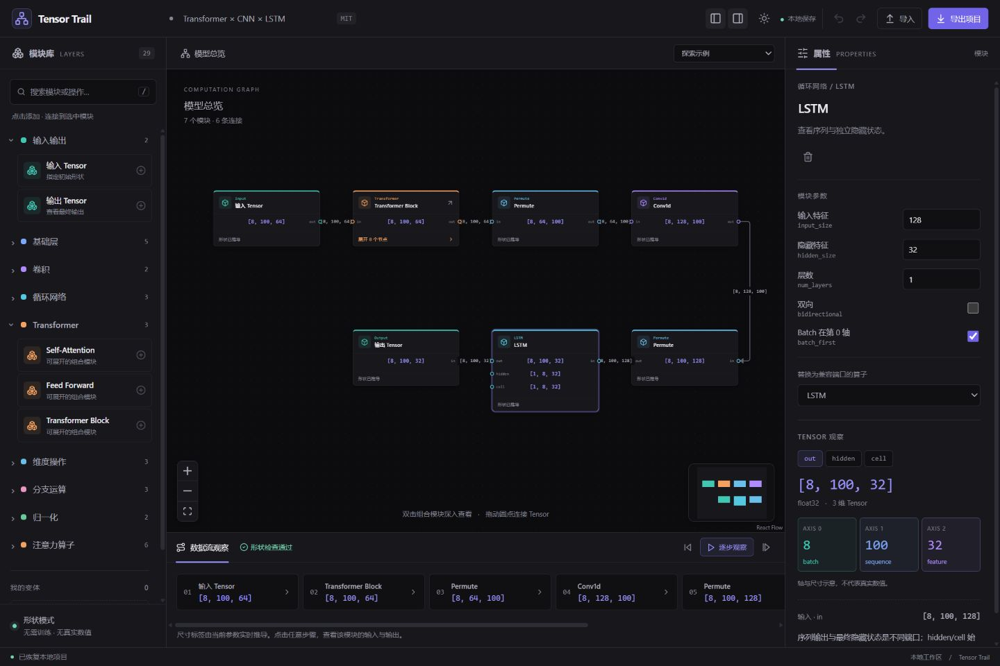

# 使用与扩展

## 启动

在项目的 app/ 中双击 start.cmd，会启动本地服务并打开浏览器。也可在 app/ 执行 `npm run dev -- --port 5178`，访问终端显示的地址。首次换设备运行先执行 `npm ci`。启动和检查命令见 [应用说明](../app/README.md)。

宽窗口采用模块库、画布、检查器三栏。宽度不超过 850px 时使用“模块库 / 画布 / 参数与形状”切换面板，适合 Codex 侧栏预览。图较大时使用左下角缩放和 Fit View，或在小地图中移动视口。

## 工作台界面

2026-10-19 的界面改版参考 TensorBloom 的编辑器布局：默认深色画布、紧凑工具栏、分类色标、属性侧栏和底部数据流面板。右上角日月按钮切换深浅主题，主题偏好保存在当前浏览器地址；两枚侧栏按钮可隐藏模块库与属性面板。切换示例或进入子图后，画布在节点测量完成时自动适应视口。

- 左侧类别可折叠，默认展开输入输出与 Transformer。点击搜索框或在非编辑状态按 `/` 搜索模块；侧栏隐藏时快捷键会重新打开它。
- 类别颜色在模块库、节点顶部和小地图保持一致：Transformer 为橙色、卷积为紫色、循环网络为青色、输入输出为绿色。名称与文字同时保留，不依赖颜色区分类别。
- 未选中模块时，右侧显示当前层级的节点数、连接数、组合模块数与模块分布；选中后显示参数和 Tensor 观察。
- 底部数据流卡片显示每一步的输出形状，继续支持单步、高亮播放和恢复全图。浏览器窗口较窄时，各面板通过顶部标签切换。



## 第一次使用

1. 打开默认“走进 Transformer”。点击 Input，编辑 shape，例如 `4, 50, 64`；axes 填写 `batch, sequence, feature`。轴名称数量要与形状维数一致，也可留空自动命名。
2. 点击 Transformer，在检查器修改 heads、d_ff、归一化位置、归一化类型及前馈结构。输入特征需匹配 d_model，d_model 必须能被 heads 整除。
3. 双击 Transformer，进入真实子图；再双击 Self-Attention，观察 Q/K/V、拆头、分数矩阵和合头。面包屑可返回上层。
4. 右上“探索示例”切换到 Transformer → CNN → LSTM。两个 Permute 分别转换序列格式与卷积的 channels-first 格式。
5. 点击 LSTM 后切换 out、hidden、cell 标签，查看不同端口的形状和轴含义。

## 添加、连接和删除

- 在画布空白处按住左键拖动进行框选，矩形碰到节点即选中；按住中键拖动平移画布。
- 左键拖动节点可移动节点；框选后可整组拖动，所有位置一起保存，一次撤销即可恢复。
- 左侧模块库与“我的变体”仅显示名称，单击条目不会添加模块。
- 从左侧模块库或“我的变体”拖到画布，在松开鼠标的位置添加独立模块。拖入时保持当前缩放和平移，不自动连线；之后拖动端口连接。进入子图后拖入会添加到当前子图，同样支持自动保存和一次撤销。
- 需要接 hidden/cell 等其他端口时，拖动相应输出圆点到目标输入圆点。修改已有连接前先点击连线并按 Delete 或 Backspace 删除。
- 选中模块后，右侧“端口布局”可分别设置输入和输出的位置，支持左、右、上、下，或恢复自动布局。多路端口会沿所选边排开，输入输出选在同一边时也会分开排列。位置设置随项目保存和导出，支持撤销，不改变形状推导。
- 每个输入端口最多一条入边。Add、Mul、Concat、MatMul 用 a、b 两个输入。禁止环路，错误会出现在底部消息区。
- 点击连线后，拖动出现的圆形控制点即可手动绕线；双击连线可增加控制点，双击控制点可删除。选中连线时的“恢复自动”可清除手动路线。拖动过程中按 Esc 可取消，每次拖动可一次撤销；控制点随项目和变体保存。模块位置和连接关系保持原有设置，移动模块或调整端口后，线的两端会继续跟随对应端口。
- 点击模块后使用检查器删除按钮，或选中模块后按 Delete。子图 Inlet/Outlet 边界节点受到保护，不可从界面删除或改端口名。
- 支持撤销和重做，保留最多 40 次编辑历史；撤销后返回模型总览。刷新不恢复撤销历史。
- “下一步”和“逐步观察”按拓扑顺序高亮模块。点击显示全部按钮恢复全图。步骤用于理解依赖，不表示真实执行耗时。

## 创建 Transformer 变体

快捷方式：选择 Transformer，修改 norm 为 RMSNorm、ffn 为 SwiGLU，给变体命名，然后点击“保存为我的变体”。左侧会出现新的模块条目，可重复拖入画布。

进一步修改：进入 Transformer 内部，选择归一化或其他普通算子，使用“替换算子”选择端口标识兼容的模块，也可添加、删除和重新连接内部节点。保存当前组合即可生成新模板。

手动编辑内部结构后，父层会标记“已自定义”，父层结构重建参数禁用，防止修改一个 heads 值覆盖整个内部编辑。此时进入子图逐个修改算子即可。移动节点、改显示名称不锁定父模块。

变体为带固定参数的子图快照。每次添加都会创建独立实例，修改一个实例不会影响模板或其他实例。第一版没有把自定义变体的内部参数重新提升为父层可编辑参数；需要改变内部特征宽度时，应修改相应的 Linear、Norm、Attention 等节点并保持约束一致。

SwiGLU 固定使用 SiLU 门控；此时 Standard FFN 的 activation 选择不改变 SwiGLU 的内部激活。Transformer 采用 batch-first，首版没有 dropout 数值执行或训练模式切换。

## 保存、导入与恢复

编辑后自动保存到当前浏览器该地址的 localStorage；状态栏标记保存情况。JSON 导出包含根图、位置、所有子图和变体库。Ctrl+S 也可导出。导入前校验协议版本、节点类型、端口、连接和嵌套深度；失败不会覆盖现有项目。

切换内置示例会替换当前图并保留当前变体库，可通过撤销返回。导入另一个项目会采用文件携带的变体库。建议在换浏览器、换端口和换电脑前导出；浏览器本地存储不是文件备份。

第一版项目上限为 3 MB 文本、100 个变体、合计 2000 个节点、每张图 8000 条边、12 层子图。编辑提交前也校验这些边界，避免保存后无法重新打开。超限可以拆分为多个项目。

## 代码扩展入口

| 要修改的内容 | 入口 |
| --- | --- |
| 新增基础算子和形状规则 | app/src/modules/primitives.ts，或新增定义文件并在 modules/index.ts 注册 |
| 新增 Transformer 组合与内部拓扑 | app/src/modules/composites.ts |
| 参数面板字段和默认值 | 每个 ModuleDefinition 的 fields |
| 端口、TensorSpec、图协议 | app/src/core/types.ts |
| 执行顺序、错误与子图传播 | app/src/core/engine.ts |
| 导入格式和迁移 | app/src/core/serialization.ts |
| 新增独立可视化效果 | app/src/views/details.tsx 的 registerDetailView |
| 修改节点卡片和轴示意 | app/src/views/ModuleNode.tsx、TensorView.tsx |
| 扩展主题与布局 | app/src/styles.css 的 CSS 变量、responsive.css；分类颜色映射位于 views/ModuleNode.tsx |
| 修改默认示例 | app/src/modules/examples.ts |

### 新增基础算子的最小例子

例如创建 app/src/modules/square.ts，提供一个形状保持算子定义：

```ts
import type { ModuleDefinition } from '../core/types';

export const square: ModuleDefinition = {
  type: 'Square',
  label: 'Square',
  category: '基础层',
  description: '逐元素平方；形状模式仅推导尺寸。',
  fields: [],
  inputs: [{ id: 'in', label: '输入' }],
  outputs: [{ id: 'out', label: '输出' }],
  infer: ({ in: x }) => ({
    outputs: { out: { ...x, shape: [...x.shape], axes: [...x.axes] } },
    notes: ['逐元素平方保持形状；这里不计算张量数值。'],
  }),
};
```

随后在 modules/index.ts 导入 square 并执行 `registry.register(square)`。它会自动出现在基础层分类，端口和参数面板也由定义产生。规则接收 TensorSpec，不接收画布节点；多输出算子返回多个命名端口。

算子参数通过 fields 声明 number/text/select/boolean；普通整数参数可指定 min。数学约束使用显式检查，失败抛出可读错误；符号维度不能证明的约束通过 warnings 返回。不要在遇到错误时假定输出等于输入。

### 新增组合模块

参考 composites.ts 的 FFN：声明 composite=true 和 build(params)，创建 Inlet、内部节点、Outlet 及端口连接。通过 registry.create 实例化基础算子和已有组合模块。build 只负责构造图，形状推导由通用引擎递归处理。使用稳定的内部节点 ID，便于视图定位；不同子图中的相同 ID 由完整路径区分。

适合先用组合实现归一化位置、激活和门控差异。RoPE、GQA 等涉及新语义时，应添加专门规则，再纳入组合；不能仅给已有 Attention 换名称。

### 新增可视化效果

details.tsx 已注册 Transformer 和 SelfAttention 的内部形状快照。新 React 组件接收 `DetailProps`，包含 node 和 result；读取 `result.outputs` 或 `result.child` 后展示。调用 `registerDetailView('模块类型', 组件)` 加入详情视图。不要在视图中重新实现 shape 公式。

未来加入动画时，保持动画进度与模型参数分离。真实热力图需要后端实际张量或明确标注的教学数据；纯形状模式不能提供真实注意力权重。高维数组应通过 batch/head/切片选择展示。

## 验证与限制

每次增加数学规则先加入手算或框架契约测试，再执行 `npm test` 和 `npm run build`。修改交互后检查浏览器的实际操作。测试入口为 tests/engine.test.ts 和 tests/store.test.ts。

首版支持 29 个可添加模块，另有内部边界与自定义 Block 类型。Conv2d 的卷积核、步长、填充、膨胀率当前共用标量，未支持每轴分别配置；MatMul 接受至少二维输入；归一化沿最后一维；Input 使用 1–8 个正尺寸轴；零长 Tensor 未支持。

符号尺寸只进行有限表达式传播，不包含完整符号求解。SelfAttention 为自注意力，暂未实现独立 Q/K/V、交叉注意力、GQA/MQA、RoPE、KV Cache。未实现任意节点框选封装、子图端口界面编辑、数值后端、训练或 PyTorch 自动导入。界面和保存协议保留扩展位置。

自有实现均在 app/。实际检查记录见 [第一版验收](第一版验收.md)。

## AI 构建与自动化入口

顶部“AI 构建”允许粘贴简化架构 JSON，自动展开、布局和检查。选“修改当前模型”可批量修改内部参数与连接。校验通过后应用，整批可一次撤销；形状警告需检查后勾选确认。新建操作保留“我的变体”。

API 位于 app/src/agent/，命令行为 app/scripts/agent.mjs，页面桥接为 app/src/editor/agentBridge.ts，面板为 AgentPanel.tsx。新增模块注册后，AI 模块目录和 Schema 自动更新；CLI 需要重新 build:agent。测试增加 tests/agent.test.ts 和 scripts/test-cli.mjs。

完整协议、命令示例、深层 path 操作、版本冲突规则与 AI 提示词见 [AI 操作指南](AI操作指南.md)。当前无内置聊天模型和 MCP 服务。
