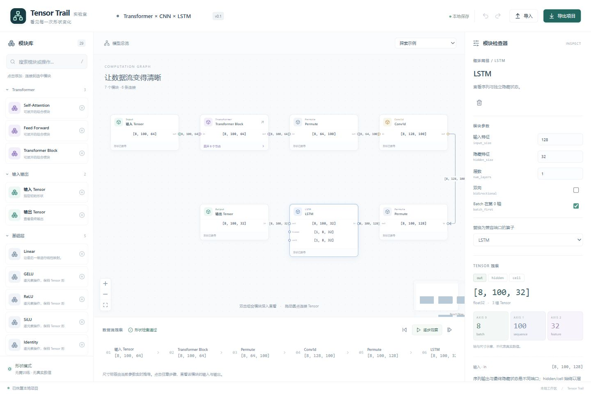

# 第一版验收

## 2026-10-19 界面改版复验

本轮由 Codex（GPT-6）根据用户要求参考 TensorBloom 调整工作台界面，MIT 保持不变。新增默认深色主题、浅色切换、左右侧栏折叠、分类色标与层级概览，重做节点、连线、属性面板及底部观察区的样式。修复折叠侧栏产生的边框溢出、子图首次打开时的适应视口时机，以及小地图尺寸与 SVG 内容不一致的问题。

- `npm test`：原有 40 项测试全部通过；未更改形状引擎、图协议或依赖版本。
- `npm run build`：TypeScript 与 Vite 生产构建通过；JS 478.38 kB（gzip 153.01 kB），CSS 42.26 kB（gzip 8.19 kB）。
- 浏览器实际验证：深浅主题切换与刷新记忆、左右侧栏隐藏及恢复、`/` 快捷搜索、搜索添加 ReLU 和撤销、heads=7 报错及恢复、Transformer → Self-Attention 二级展开、LSTM cell 输出 [1,8,32]、单步与恢复全图。
- 桌面 1440×960 与窄屏 390×844 验证通过；侧栏全收起和窄屏面板均无页面横向溢出。混合网络在重新载入后自动完整适应画布；节点形状与原版一致。
- 最终生产预览检查未见浏览器 console error/warn。验证使用独立本地端口，未覆盖用户现有工作区的模型数据。

当前界面截图：

以下保留首版原始验收记录。

| 场景 | 预期 |
| --- | --- |
| 编辑输入 | 修改 shape 后节点、连接和端口结果同步更新 |
| 基础组合 | 添加线性、卷积、循环网络、维度操作及分支模块 |
| Transformer 展开 | 从整体进入 Attention，查看 Q/K/V 与分数形状 |
| 参数约束 | d_model=64、heads=7 显示不整除错误 |
| 混合网络 | [8,100,64] 经 Transformer、Permute、Conv1d、Permute、LSTM 得到 [8,100,32] |
| 变体 | 修改结构或内部节点，保存并重用独立变体 |
| 分支与端口 | LSTM hidden/cell 独立；Add 双输入；拒绝环路 |
| 保存恢复 | JSON 保留子图与变体；刷新恢复本地项目 |
| 可视化 | 轴含义与分步高亮；明确标注形状模式 |
| 工程检查 | 核心测试、类型检查、生产构建与浏览器验收 |

## 实际结果

2026-10-18，Codex（GPT-6）完成 v0.1 实现与验证。自有代码在 app/。

### 自动检查

- `npm test`：2 个测试文件、40 项测试全部通过，其中形状/图/序列化 32 项，编辑/持久化事务 8 项。
- `npm run build`：TypeScript 检查通过，Vite 6.4.4 生产构建成功。最终产物约 JS 473.63 kB（gzip 151.79 kB）、CSS 36.98 kB（gzip 7.67 kB）。
- `npm run format`：全部自有源码和测试已统一格式。
- 测试环境：Windows、Node.js 20.15.1、Vitest 3.2.7。依赖版本锁定在 app/package-lock.json。

测试依据为手算结果和公开算子契约。本轮没有运行 PyTorch 做独立数值对照，因此不宣称数值执行或框架一致性已验证。

### 浏览器实际操作

| 操作 | 观察结果 |
| --- | --- |
| heads 从 8 改为 7 | 显示“特征维度 64 无法被 7 个注意力头整除”，下游输出阻断 |
| 恢复 heads=8，设置 RMSNorm + SwiGLU | 整体输出仍为 [8,100,64]，可保存为命名变体 |
| Input 改为 [4,50,64] | Transformer 内外与全部有效连线同步更新 |
| 两层展开到 Attention，并选中 Q × Kᵀ | 输入 [4,8,50,8] 与 [4,8,8,50]，输出 [4,8,50,50] |
| 在内部把归一化算子替换为 LayerNorm | 形状正确；父 Transformer 标记自定义并保护内部编辑 |
| 保存并再次添加 RMSNorm + SwiGLU 变体 | 新实例独立出现、自动连接，输出 [4,50,64] |
| 从空白画布添加 Linear、Output | 创建 Input → Linear → Output，实时输出 [8,100,64] |
| 点击连线并按 Delete | 下游明确显示等待输入/上游修正 |
| 拖动输入与输出圆点重新连线 | 连接恢复、形状检查通过 |
| 撤销与重做 | 可恢复添加前后的模型状态 |
| 导出 JSON，再切换空白示例并导入 | 完整恢复 [4,50,64] 项目、子图、自定义状态和变体库 |
| 刷新页面 | 恢复浏览器本地项目和变体；撤销历史按设计不保留 |
| 混合网络示例 | Conv1d 输出 [8,128,100]，LSTM 序列输出 [8,100,32]，hidden/cell 为 [1,8,32] |
| 下一步与显示全部 | 能按拓扑顺序高亮，并恢复全图显示 |
| 窄窗口与 1440×960 桌面布局 | 窄窗口切换面板；桌面显示模块库、画布与检查器三栏 |
| 构建产物的本地 preview | 成功载入和恢复项目，最后检查未见控制台 error/warn |

桌面尺寸覆盖只用于响应式验收，结束时已恢复浏览器正常尺寸。本地预览使用 http://127.0.0.1:5178/，服务停止后需重新启动。

### 界面截图

### 已知范围与下一步

- 当前仅推导形状，不生成真实张量、权重、梯度或注意力热力图。
- 可展开 Transformer、SelfAttention、FFN；支持 Pre-/Post-Norm、LayerNorm/RMSNorm、标准 FFN/SwiGLU 和因果 Mask 的形状语义。
- 自定义变体采用完整子图快照，尚无内部参数提升、任意节点框选封装、边界端口界面编辑。
- 符号尺寸仅有限传播；Conv2d 空间参数为共用标量，MatMul 至少二维。更完整的算子范围见 [使用与扩展](使用与扩展.md)。
- 下一步可按用户关注的具体模型增加 RoPE/GQA、教学动画和 PyTorch 数值验证。

## AI 操作层验收（2026-10-19）

- npm test：3 个文件、63 项测试通过（原引擎 32、编辑事务 9、AI API 22）。覆盖展开、混合网络、Block、深层诊断、非法参数/图、资源限制、原子修改、祖先保护、revision 冲突与警告确认。store 测试验证一次撤销、保留变体与持久化。
- npm run build：TypeScript 检查与网页/独立 SDK 构建通过。网页 JS 497.82 kB（gzip 159.80 kB）、CSS 46.03 kB（gzip 8.91 kB）；SDK 53.51 kB（gzip 15.90 kB）。
- npm run test:cli：模块目录、Schema、build/validate/patch、stdin、错误退出码和写入保护通过；默认不覆盖输出，形状错误时即使 force 也保持原文件不变。
- 浏览器实际验证：Recipe 构建 CNN → Transformer → 双向 LSTM，35 个展开节点，输出 [8,100,64]；Patch 改为 RMSNorm + SwiGLU 后为 37 个节点、形状保持；应用、一次撤销和刷新恢复正常。
- heads=7 与 d_model=128 不兼容时显示 SHAPE_ERROR，后续 LSTM/Output 为 UPSTREAM_BLOCKED，“应用到画布”禁用。
- 默认桌面深色界面、390×844 窄屏浅色面板均正常，控制台无 error/warn；测试后恢复窗口尺寸。使用独立 5179 端口，未改变用户 5178 工作区模型。
- 文档与示例见 [AI 操作指南](AI操作指南.md)。没有执行数值前向，也未接入大模型、MCP 或远程 HTTP 写入服务。

